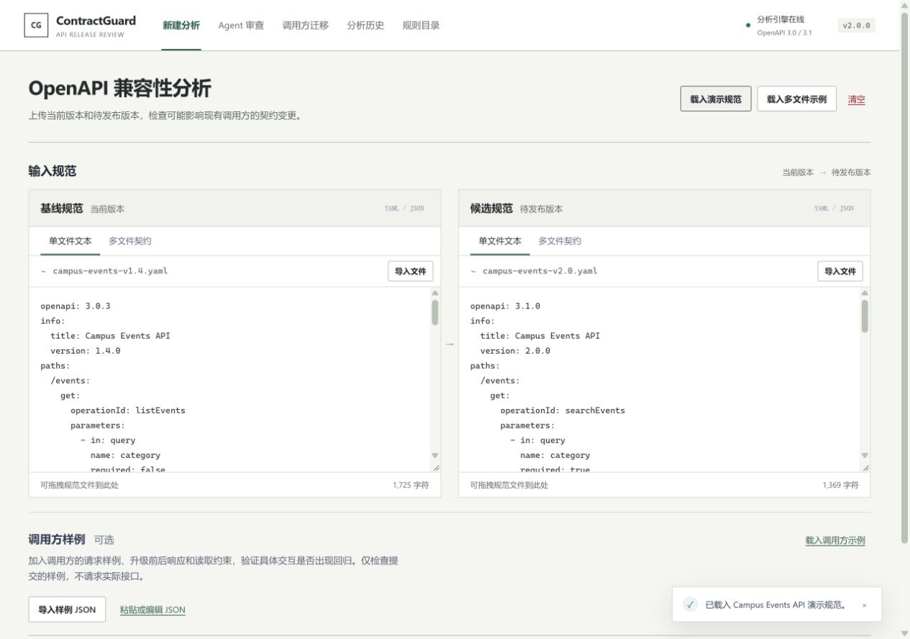

# ContractGuard

**Follow an API change from its contract to the code that consumes it.**

[简体中文](README.zh-CN.md) · [User guide / 使用文档](docs/v2.0-user-guide.md) · [2.0 release notes](docs/releases/v2.0.0.en.md)

[](https://github.com/Reizen721/ContractGuard/actions/workflows/ci.yml)
[](https://github.com/Reizen721/ContractGuard/releases)
[](LICENSE)
[](package.json)

ContractGuard is a local API change review workbench and MCP plugin. It combines OpenAPI compatibility findings, TypeScript caller evidence, migration proposals and existing project tests in a saved review. Use it in a browser, from the command line, or through an MCP-capable agent.

An optional LLM can plan the review and explain findings. Checks and the release gate remain deterministic.



## What a review answers

| Question | Evidence you can inspect |
| --- | --- |
| What changed in the API contract? | Directional native rules, official oasdiff checks, contract locations and coverage limitations |
| Which supplied callers rely on it? | TypeScript callsites, field accesses, source fingerprints and bounded response replay |
| Does the candidate break the selected project tests? | Baseline and candidate runs of registered Node/Vitest test files |
| Does a proposed migration help? | Explicit field-rename diffs, caller re-verification and a patched test run when applicable |
| Can we revisit this decision? | Saved review IDs, linked evidence, history and reports shared by Web and MCP |

The included orders example changes `customerName` to `displayName`. One caller fails while an identifier lookup still works. ContractGuard proposes the explicitly supplied rename and runs the same existing tests against baseline, candidate and patched copies. A passing patch does **not** erase the original API compatibility risk.

## Start locally

Requirements: **Node.js 22.13+** and **pnpm 11.19.0**. If pnpm is missing, run `npm install --global pnpm@11.19.0`. On Windows, use `npm.cmd` / `pnpm.cmd` if PowerShell blocks the corresponding `.ps1` script.

```bash
git clone https://github.com/Reizen721/ContractGuard.git
cd ContractGuard
pnpm install --frozen-lockfile
pnpm engine:install
pnpm build
pnpm start
```

Open **http://127.0.0.1:8080**. Contract analysis and workflow reviews need no model account. `engine:install` downloads the pinned official oasdiff binary; subsequent local checks use that installed binary.

On Windows, installation and startup are also available through:

```powershell
.\start-contractguard.bat --install --no-ai
```

For a complete caller-migration demo, stop the server with `Ctrl+C`, then load the supplied project registry:

```powershell
.\start-contractguard.bat --projects .\fixtures\project-tests\demo-registry.json --no-ai
```

In the Agent workspace, select **订单字段迁移与已有测试** (`orders-migration`) and run a **workflow** review. Inspect contract findings, caller migration and three test phases. Expected test results: **2 passed → 1 passed / 1 failed → 2 passed**. This deliberately breaking example retains a blocked gate.

On macOS/Linux, start the same demo with:

```bash
CONTRACTGUARD_PROJECT_CONFIG="$PWD/fixtures/project-tests/demo-registry.json" pnpm start
```

## Use it in an agent

Keep the service running, then generate the plugin and client configuration:

```bash
pnpm plugin:prepare
```

`.tools/agent-plugin/` contains a portable plugin, local marketplace and configuration fragments for Codex, Antigravity, DeepSeek Harness and generic MCP clients. The transport is **local stdio** using Node.js and the existing HTTP service; this is not a hosted remote MCP endpoint.

With Codex CLI installed, `pnpm plugin:prepare --codex` registers the MCP server. For other hosts, merge the generated fragment with existing settings and reload the host. For a different service port, use `pnpm plugin:prepare --api-url http://127.0.0.1:18083`. Keys stay in the service process, outside plugin configuration.

Try this after registering the demo:

> Use ContractGuard to list projects, then review `orders-migration` in workflow mode. Wait for completion. Explain the contract risks, affected callers and baseline/candidate/patched test results with evidence IDs. Show the proposed migration without modifying my source files.

The **19 MCP tools** cover analysis, saved AI explanations, project discovery, Agent reviews, caller migration, history, cancellation and report export. Web and MCP share records when connected to the same service. See the [host installation guide](docs/v2.0-user-guide.md#6-在-codexantigravity-或其他-agent-中使用).

## Optional DeepSeek planning

For first-time Windows configuration:

```powershell
Copy-Item .\config\llm-providers.example.json .\config\llm-providers.local.json
.\start-contractguard.bat --projects .\fixtures\project-tests\demo-registry.json
```

Enter your key at the **hidden local terminal prompt**. It is used by the process, not saved in JSON. Preserve an existing local profile when upgrading. The example selects `deepseek-cloud`; verify its model ID is available to your account.

**LLM** mode lets the model select permitted checks and synthesize evidence-linked advice. **Workflow** uses a fixed model-free sequence. The separate **AI explanation** action interprets a completed analysis; it does not run an Agent review. Cloud calls incur normal provider charges. See [configuration and data boundaries](docs/v2.0-user-guide.md#5-配置-deepseek).

## CLI and CI

```bash
# Quick contract example
pnpm demo

# CI gate: exit 2 when breaking changes are found
pnpm contractguard compare fixtures/petstore-v1.yaml fixtures/petstore-v2-breaking.yaml --format markdown --output contractguard-report.md --fail-on breaking

# Local multi-file contracts
pnpm contractguard compare fixtures/multifile/baseline/openapi.yaml fixtures/multifile/candidate/openapi.yaml --bundle --fail-on never

# Native rules, caller evidence and existing project tests
pnpm contractguard review-project orders-migration --registry fixtures/project-tests/demo-registry.json --format json --fail-on never

# Official engine CLI passthrough
pnpm contractguard oasdiff --help
```

`compare` and `review-project` are local CLI workflows, not the complete built-in Agent sequence. Use the Agent workspace/MCP review or CLI `agent` command to combine both engines. CLI-created records do not automatically enter the HTTP service's history.

## Scope and trust

- Native normalization targets OpenAPI **3.0/3.1**, including bounded local multi-file bundles. Remote references are not fetched. Unsupported semantics remain visible as partial coverage or inconclusive evidence.
- Caller analysis uses a bounded TypeScript interpreter, without executing arbitrary submitted source or making live API requests. Unknown SDKs and unsupported syntax need review.
- Project tests execute trusted Node.js code in temporary source copies with fixed runners and limits. **This is not an OS sandbox.** Register projects and dependencies you trust; passing selected tests does not prove all consumers compatible.
- Migration proposals cover explicit supported field renames. ContractGuard does not repair arbitrary applications or edit the original project.
- Model advice needs review. Evidence-reference validation confirms references exist, not that every natural-language recommendation is correct.

The upstream engine is **official oasdiff 1.35.0**, pinned and attributed. Native rules, caller evidence, test orchestration, persistence and MCP access are ContractGuard components. See [capability boundaries](docs/oasdiff-capabilities.md) and [third-party notices](THIRD_PARTY_NOTICES.md).

## Documentation and verification

| Topic | Reference |
| --- | --- |
| Installation, demo, project registration, AI and MCP | [2.0 user guide](docs/v2.0-user-guide.md) |
| Release and upgrade | [English](docs/releases/v2.0.0.en.md) · [中文](docs/releases/v2.0.0.zh-CN.md) · [Changelog](CHANGELOG.md) |
| Integration and development | [HTTP API](docs/api-reference.md) · [Architecture](docs/architecture.md) · [Development](docs/development.md) |
| Rules and implementation limits | [Native rules](docs/compatibility-rules.md) · [Caller migration](docs/v1.7-caller-migration.md) · [Project runner](docs/v1.8-project-agent.md) |
| Evidence | [2.0 verification](docs/v2.0-verification.md) · [Verification history](docs/verification.md) · [Public-project benchmark](docs/v1.8-benchmark.md) · [Prior real DeepSeek acceptance](docs/v1.8-deepseek-acceptance.md) |
| Deliverables | [Delivery checklist](docs/delivery-checklist.md) |

`pnpm check` runs builds, type checks, tests and cross-entry regressions. Live DeepSeek acceptance is opt-in, outside the default model-free suite. Historical evidence is labelled by the version actually tested.

OpenAPI describes HTTP API paths, parameters, requests and responses. Official specifications: [overview](https://spec.openapis.org/oas/), [3.0.4](https://spec.openapis.org/oas/v3.0.4.html), [3.1.2](https://spec.openapis.org/oas/v3.1.2.html).

## License

[MIT](LICENSE). Third-party components retain their own licenses: [THIRD_PARTY_NOTICES.md](THIRD_PARTY_NOTICES.md).
