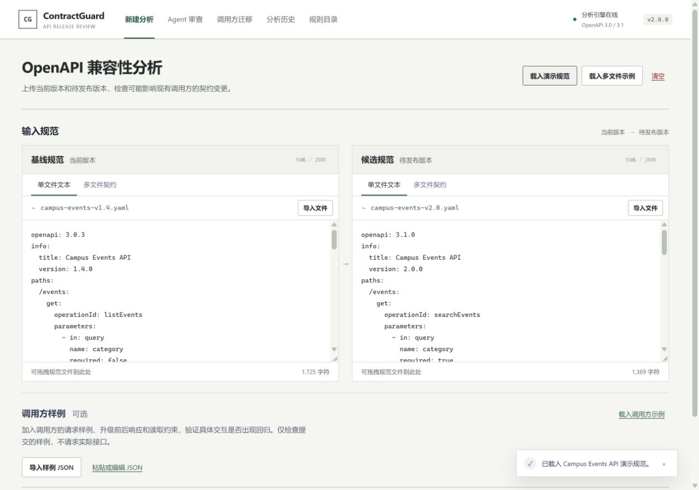

# ContractGuard

**从 API 契约变更，追踪到调用代码和已有测试。**

[English](README.md) · [完整使用文档](docs/v2.0-user-guide.md) · [2.0 发布说明](docs/releases/v2.0.0.zh-CN.md)

[](https://github.com/Reizen721/ContractGuard/actions/workflows/ci.yml)
[](https://github.com/Reizen721/ContractGuard/releases)
[](LICENSE)
[](package.json)

ContractGuard 是本地运行的 OpenAPI 兼容性审查工作台、神经符号反例精化（CEGAR）自修复 Agent 与 MCP 插件。它将 OpenAPI 3.0/3.1 差异分析、跨文件 `ts.TypeChecker` 程序切片、符号 AST 重写与大模型混合补丁合成，以及断网四门验证沙箱（严格类型检查、回归单测、出站请求契约校验与差分对抗见证 Fuzzing）组织为可追溯的审查记录，支持通过网页、CLI 或支持 MCP 的 Coding Agent 调用。

可选的大模型负责规划检查和解释证据；检查结果与发布门禁由确定性逻辑决定。



## 一次审查解决哪些问题

| 你要确认的问题 | 可以检查的证据 |
| --- | --- |
| API 契约具体变了什么？ | 原生方向性规则、官方 oasdiff 检查、契约位置和未覆盖范围 |
| 哪些已提供的调用代码依赖这些变化？ | TypeScript 调用位置、字段访问、源码指纹和有限响应重放 |
| 候选版本会让项目已有测试失败吗？ | 注册的 Node/Vitest 测试在基线与候选副本上的实际执行结果 |
| 提议的迁移能否解决问题？ | 显式字段重命名 diff、调用方复核，以及适用时的补丁测试 |
| 以后如何复查决定？ | 网页与 MCP 共用的记录 ID、证据引用、历史和报告导出 |

内置订单示例把 `customerName` 改为 `displayName`：读取客户名称的调用失败，读取订单编号的调用仍正常。ContractGuard 根据明确提供的重命名映射生成候选补丁，并让同一组已有测试分别运行于基线、候选和补丁副本。补丁通过后，原来的 API 兼容风险仍然保留。

## 本地开始

需要 **Node.js 22.13 及以上**、**pnpm 11.19.0**。没有 pnpm 时先运行 `npm install --global pnpm@11.19.0`。Windows PowerShell 若禁止运行 `.ps1` 脚本，可以使用 `npm.cmd`、`pnpm.cmd`。

```bash
git clone https://github.com/Reizen721/ContractGuard.git
cd ContractGuard
pnpm install --frozen-lockfile
pnpm engine:install
pnpm build
pnpm start
```

打开 **http://127.0.0.1:8080**。普通契约分析和 workflow 审查不需要模型账号。`engine:install` 下载固定版本的官方 oasdiff；安装后，本地检查直接使用该二进制。

Windows 也可以用启动器完成安装与启动：

```powershell
.\start-contractguard.bat --install --no-ai
```

体验完整调用方迁移流程时，先按 `Ctrl+C` 停止服务，再加载内置项目注册表：

```powershell
.\start-contractguard.bat --projects .\fixtures\project-tests\demo-registry.json --no-ai
```

在 Agent 工作区选择 **订单字段迁移与已有测试**（`orders-migration`），运行 **workflow** 审查，查看契约问题、调用方迁移和三阶段测试。预期结果为 **2 项通过 → 1 项通过 / 1 项失败 → 2 项通过**。这是刻意包含破坏性变更的示例，因此最终门禁仍为阻断。

macOS/Linux 使用同一注册表：

```bash
CONTRACTGUARD_PROJECT_CONFIG="$PWD/fixtures/project-tests/demo-registry.json" pnpm start
```

## 接入 Agent

保持服务运行，在另一个终端生成插件与配置：

```bash
pnpm plugin:prepare
```

`.tools/agent-plugin/` 包含可移动插件、本地 marketplace，以及 Codex、Antigravity、DeepSeek Harness 和通用 MCP 客户端的配置片段。接入方式是 **本地 stdio + Node.js + 已启动的 HTTP 服务**，不提供托管的远程 MCP 地址。

安装了 Codex CLI 时，`pnpm plugin:prepare --codex` 可以直接注册 MCP 服务。其他宿主请合并生成的配置片段并重新加载工具。API 使用其他端口时，运行 `pnpm plugin:prepare --api-url http://127.0.0.1:18083`。密钥留在服务进程，不放进插件配置。

注册内置项目后，可以向 Agent 输入：

> 使用 ContractGuard 列出可用项目，以 workflow 模式审查 orders-migration，并等待完成。引用证据 ID 解释契约风险、受影响调用方和基线/候选/补丁测试结果。展示迁移建议，不修改我的源文件。

共 **19 个 MCP 工具**，覆盖契约分析、AI 风险解读、项目发现、发布审查、多轮 CEGAR 自修复（`contractguard_run_cegar` / `get_cegar_run` / `list_cegar_runs` / `export_cegar_run`）、轻量 AST 重放、取消与分块报告导出。连接同一个服务地址时，网页和 MCP 看到相同记录。详见[宿主接入说明](docs/v2.0-user-guide.md#6-在-codexantigravity-或其他-agent-中使用)。

## 配置 DeepSeek 自主编排

首次在 Windows 配置：

```powershell
Copy-Item .\config\llm-providers.example.json .\config\llm-providers.local.json
.\start-contractguard.bat --projects .\fixtures\project-tests\demo-registry.json
```

在启动器的**本地隐藏输入提示**中填写 Key。密钥仅供该进程使用，不写入 JSON。升级时保留已有本地配置。示例选择 `deepseek-cloud` 档案，请确认其中的模型 ID 对你的账号可用。

**LLM** 模式允许模型选择白名单检查并生成关联证据的建议；**workflow** 模式执行固定检查，无需模型。单次分析中的 **AI 解读** 只解释已完成的结果，与 Agent 审查是两个入口。云端调用按服务商规则计费。详见[配置与数据边界](docs/v2.0-user-guide.md#5-配置-deepseek)。

## 命令行与 CI

```bash
# 快速查看契约示例
pnpm demo

# CI 门禁：发现 breaking 时退出码为 2
pnpm contractguard compare fixtures/petstore-v1.yaml fixtures/petstore-v2-breaking.yaml --format markdown --output contractguard-report.md --fail-on breaking

# 本地多文件契约
pnpm contractguard compare fixtures/multifile/baseline/openapi.yaml fixtures/multifile/candidate/openapi.yaml --bundle --fail-on never

# 原生规则、调用方证据与项目已有测试
pnpm contractguard review-project orders-migration --registry fixtures/project-tests/demo-registry.json --format json --fail-on never

# 官方引擎 CLI 透传
pnpm contractguard oasdiff --help
```

`compare` 和 `review-project` 是本地 CLI 流程，并非完整内置 Agent 检查序列。组合两个契约引擎可使用网页/MCP 审查，或 CLI 的 `agent` 命令。CLI 独立创建的记录不会自动进入 HTTP 服务的共用历史。

## 能力边界

- 原生规范化面向 OpenAPI **3.0/3.1**，支持有界的本地多文件契约；不会抓取远程引用。未支持语义会显示为覆盖不完整或结论不确定。
- 调用方分析使用有限 TypeScript 解释器，不执行任意提交源码、不发送真实 API 请求。未知 SDK 和不支持的语法需要复核。
- 项目测试在临时源码副本中通过固定 runner 执行可信的 Node.js 代码，并限制时间和输出。**这不是操作系统沙箱。** 只注册你信任的项目和依赖；选定测试通过不代表全部调用方兼容。
- 迁移建议覆盖明确支持的字段重命名，不会独立修复任意应用，也不会修改原项目。
- 模型建议需要审阅。证据引用校验能确认引用存在，不能证明每一句自然语言建议都正确。

集成的上游引擎为固定版本 **官方 oasdiff 1.35.0**；原生规则、调用方证据、测试编排、持久化和 MCP 接入由 ContractGuard 实现。参见[能力边界](docs/oasdiff-capabilities.md)与[第三方声明](THIRD_PARTY_NOTICES.md)。

## 文档与验证

| 需要做什么 | 文档 |
| --- | --- |
| 安装、示例、接入项目、配置 AI 和 MCP | [2.0 完整使用指南](docs/v2.0-user-guide.md) |
| 查看发布与升级说明 | [中文](docs/releases/v2.0.0.zh-CN.md) · [English](docs/releases/v2.0.0.en.md) · [变更记录](CHANGELOG.md) |
| 开发或对接接口 | [HTTP API](docs/api-reference.md) · [系统架构](docs/architecture.md) · [开发指南](docs/development.md) |
| 查看规则和实现范围 | [原生规则](docs/compatibility-rules.md) · [调用方迁移](docs/v1.7-caller-migration.md) · [项目测试](docs/v1.8-project-agent.md) |
| 复查验证证据 | [2.0 验证](docs/v2.0-verification.md) · [历史记录](docs/verification.md) · [公开项目对照](docs/v1.8-benchmark.md) · [上一版本真实 DeepSeek 验收](docs/v1.8-deepseek-acceptance.md) |
| 神经符号 CEGAR Agent 与基准集 | [CEGAR 架构说明](docs/CEGAR_AGENT_ARCHITECTURE.md) · [ContractBench 报告](benchmarks/contractbench/REPORT.md) |
| 检查交付内容 | [交付清单](docs/delivery-checklist.md) |

`pnpm check` 包含构建、类型检查、自动化测试和跨入口回归；真实 DeepSeek 验收需要显式运行，不属于默认无模型测试。历史验证按照实际测试版本标注。

OpenAPI 用于描述 HTTP API 的路径、参数、请求和响应。官方规范：[总入口](https://spec.openapis.org/oas/)、[3.0.4](https://spec.openapis.org/oas/v3.0.4.html)、[3.1.2](https://spec.openapis.org/oas/v3.1.2.html)。

## 许可

[MIT](LICENSE)。第三方组件保留各自许可，见 [THIRD_PARTY_NOTICES.md](THIRD_PARTY_NOTICES.md)。
