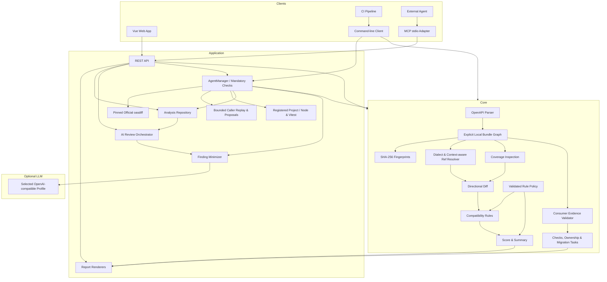
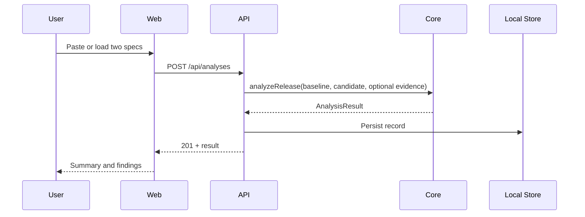
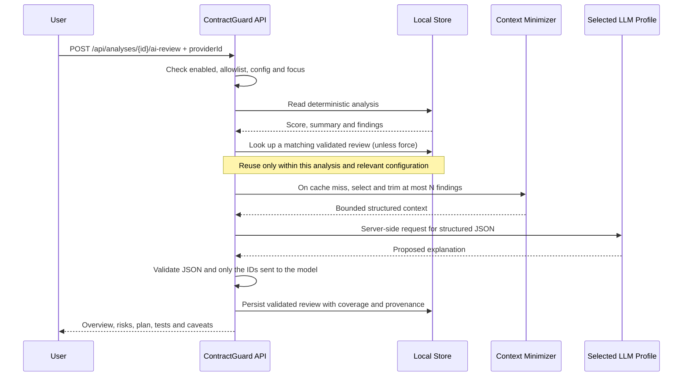

# 系统架构 / Architecture

## 1. 设计目标

当前 **2.0** 通过 `Web / 外部 Agent → MCP stdio → HTTP API` 接入同一个审查服务。`packages/mcp` 只做工具参数校验、错误映射、分页和报告分块，不复制规则、模型配置或存储。插件不会启动第二个 AgentManager；关闭插件也不会关闭共享服务。网页与插件连接同一个 HTTP 地址时读写相同记录，CLI 独立存储方式不变。见 [2.0 使用指南](v2.0-user-guide.md)。

任务编排为 `AgentManager → 官方 oasdiff + analyzeRelease + 调用方检查 + 已注册项目测试 → 确定性门禁与证据关联建议`。模型只在显式 llm 模式中选择允许的工具；workflow 模式无模型。`packages/caller` 对提供的 TypeScript 源码进行有限解释与迁移复核，`packages/project` 在快照副本执行明确登记的可信测试；这两类执行边界不同，项目测试不是操作系统沙箱。任务记录与单次分析记录分别保存，补丁测试通过不覆盖原契约风险。详见 [Agent 设计](agent-design.md)、[项目接入](v1.8-project-agent.md)和[能力矩阵](oasdiff-capabilities.md)。下文原生核心的分数不能代表上游或 Agent 的全部结论。

ContractGuard 的架构围绕四个目标展开：

1. **一致性：** Web、REST API 与 CLI 使用同一个核心引擎，避免不同入口得出不同结论。
2. **可解释：** 分析结果必须能定位到规则和契约位置，并在适用时给出前后值。
3. **本地优先：** 确定性分析、报告和 workflow 无需云模型；云端 AI 是可选的解释与有界规划层。
4. **可替换：** UI、存储、报告与 AI provider 围绕稳定的分析结果模型组合，可以独立扩展。

## 2. 逻辑架构



核心包是无 UI、无网络、无数据库依赖的 TypeScript 模块。API 与 CLI 调用 `analyzeRelease`：先保留原有 `analyzeCompatibility` 的静态结果，再按需加入独立的调用方证据结果。Web 只消费 API，不复制规则判断。AI 报告解释器读取已经完成的分析，Agent 规划器根据工具观察选择允许的动作；两者都不能改写 `Change`、分数、兼容结论或调用方门禁。图中的 Finding Minimizer 表示各模型入口的有界摘要，具体字段由各自提取器控制。

## 3. 工作区组成

| 目录 | 职责 | 主要边界 |
| --- | --- | --- |
| `packages/core` | 解析、标准化、差异检测、规则、计分、公共类型 | 不读写数据库，不依赖 Web 框架 |
| `packages/oasdiff` | 固定官方引擎、受限执行与独立 CLI 透传 | 上游版本与自有版本独立；网页不暴露全部 CLI 参数 |
| `packages/caller` | 有界 TypeScript 重放、位置证据、显式字段迁移 | 不执行任意提交源码，不调用线上 API |
| `packages/project` | 本机项目注册、快照、Node/Vitest 三阶段测试 | 执行可信项目代码，不是 OS 沙箱，不修改原项目 |
| `packages/mcp` | 标准 MCP 工具、HTTP 桥接、分页与报告分块 | 固定本机地址，不拥有密钥或独立历史 |
| `plugins/contractguard` | 可导入插件的清单与使用 skill | 构建后附带自足的 Node 运行文件；API 服务独立启动 |
| `apps/api` | HTTP 接口、输入限制、历史存储、报告导出 | 不重新实现规则 |
| `apps/web` | Vue 单页应用、编辑/导入、筛选、历史与导出 | 不直接访问本地文件系统 |
| `apps/cli` | 文件读取、终端输出、退出码 | 复用 `core` 的结果模型 |
| `fixtures` | 可复现的输入契约 | 不作为生产规范 |
| `config` | LLM Profile 与规则策略 Schema/样例 | 真实 key 不进入 JSON |
| `docs` | 使用、设计、规则与评估文档 | 与实际版本同步维护 |

多 LLM 适配与 AI HTTP 路由属于 API 边界，而不是 `packages/core`。这能保证核心包在离线环境、测试和 CLI 中没有隐式网络行为。规则策略的严格校验、应用和指纹则属于核心包，使 API 与 CLI 使用同一治理口径。

## 4. 核心数据流

### 4.1 输入

基线与候选输入可以是 YAML 文本、JSON 文本、已解析对象，或 V1.3 的显式文件包 `{ kind: 'bundle', entry, files: [{ path, content }] }`；两侧可以使用不同形式。解析阶段检查顶层结构和 `openapi` 版本字段，对无法解析的内容返回结构化错误，并记录 SHA-256 输入身份。单文件文本按输入字节、对象按稳定规范化 JSON 计算，文件扩展名不是可信依据。

文件包的 `path` 是包内虚拟路径，API 和核心不会根据它读取服务器磁盘或发起网络请求。包解析器只接受显式文件，构造引用图并重写为内存中的本地引用，保留循环关系而不无限内联。每包最多 50 个 YAML/JSON 文件，所有 `content` 的 UTF-8 大小合计最多 5 MiB，另有展开值、图节点、引用数和深度预算。HTTP 还受配置的单份输入与整体请求体限制。

相对文件引用和 JSON Pointer 可以跨包内文件，`../` 必须仍位于允许根内。远程地址、绝对/驱动器/UNC 路径、含糊文件名、反斜杠、百分号编码文件路径和查询串会被拒绝；缺失依赖、命名 anchor 及需要 `$id` 资源基址解析的包引用明确报错。入口和实际传递依赖按稳定路径排序后生成包指纹；`source.*.bundle` 保存入口与逐文件指纹，未使用文件和清单顺序不改变依赖身份。

CLI 的 `--bundle` 是独立的磁盘加载层：默认只在入口所在目录内按依赖读取文件，也可显式指定两侧允许根。加载前后检查真实路径和符号链接边界。它面向受信任的本地目录，不保证抵御恶意本机进程在检查和读取间换文件；没有 `--bundle` 时不跟随磁盘上的跨文件引用。Web 则由用户选择文件或目录后发送显式包，详见 [V1.3 升级与多文件使用](./v1.3-upgrade.md)。

### 4.2 标准化

OpenAPI 允许参数出现在 path 和 operation 两层，也允许大量 `$ref`。标准化层负责合并继承关系、统一缺省值，并在已准备好的单文件或文件包引用图内解析引用，使规则不必重复处理语法差异。

V1.3 将 `source.*.dialect` 随结果保留：3.0 使用自身 Schema 规则，3.1 使用声明的 `jsonSchemaDialect` 或默认 OAS 3.1 方言。3.0 的 `nullable` 只作用于显式类型；3.1 的 null 使用联合类型，旧式 `nullable` 不生效并提示。不会因为存在 `properties` 或 `items` 就补出对象或数组类型。

解析器按上下文区分 Reference Object、Schema 和 Path Item。3.0 Reference Object / Schema 的 `$ref` 旁字段忽略，3.1 普通 Reference Object 仅接受 `summary`、`description`；3.1 Schema 的相邻约束按合取处理，可安全合并的简单约束归一化，其余保留 `allOf`。Path Item 保留不冲突的相邻操作，重名字段冲突时标记 partial 并停止对该路径作精确差异判断。属性名映射和示例载荷不会被误当成 Reference Object 或 Schema。

标准化必须保留“这是请求还是响应”的上下文，因为兼容方向不同：

```text
request:  old accepted values ⊆ new accepted values  通常才是向后兼容
response: new produced values ⊆ old understood values 通常才是向后兼容
```

### 4.3 差异与规则

差异层按 `path + HTTP method` 匹配操作，再比较参数、请求体、响应和 schema。规则层把结构差异转成领域结论。每个 `Change` 包含：

```ts
type Severity =
  | 'breaking'
  | 'potentially-breaking'
  | 'non-breaking'
  | 'info';

interface Change {
  id: string;
  ruleId: string;
  severity: Severity;
  category: string;
  location: string;
  message: string;
  before?: unknown;
  after?: unknown;
  recommendation?: string;
  sourceLocations?: {
    old?: { file: string; pointer: string };
    new?: { file: string; pointer: string };
  };
}
```

结果中的 `id` 用于一次分析内稳定定位，`ruleId` 表示可版本化的判定类型。多文件来源映射保留原文件和 JSON Pointer，不把内部打包路径暴露为用户位置。合成字段无法精确对应时使用最近已知祖先，不伪造编辑器行号。具体规则见 [compatibility-rules.md](./compatibility-rules.md)。

### 4.4 汇总与计分

`AnalysisResult` 保存来源元数据、引擎版本、生成时间、分类计数、变化列表、兼容结论与 0–100 的展示分。当前权重为每条 breaking 扣 12 分、每条 potentially-breaking 扣 4 分，最低为 0；分数不替代明细。`compatible` 只表示没有发现明确的 breaking 变化，与分数阈值无关。

为了可复现，计分不包含随机因素或远程模型调用。更改权重时必须提升规则/引擎版本，并在评估记录中说明。AI 响应中的 `riskLevel` 或 `priority` 是表达层信息，不能参与此处计算。

### 4.5 覆盖范围

在差异比较前，覆盖扫描沿实际操作、参数、请求体、响应和 Schema 位置检查已知限制。未知方言、资源作用域、复杂关键字、组合 Schema、循环/递归预算、callbacks、webhooks、links、media encoding 等会产生 `coverage.warnings`；示例和默认值中的 JSON 不作为契约关键字扫描。未知方言或资源作用域影响的 Schema 标为不可精确分析，避免后续规则对其给出虚假的安全结论。缺失或非法引用属于输入失败，不靠 coverage 掩盖。

`coverage.status` 为 `complete` 或 `partial`，并附最多 100 条按位置稳定排序的告警和 `truncated` 标记。complete 仅表示在当前实现范围内没有已知告警，不是完整 OpenAPI 校验或形式化安全证明；partial 也不是数值准确率。覆盖结果不受规则策略的启停和等级调整影响，与 `compatible` 独立。旧历史缺少该字段时保持未知。CLI 可用 `--fail-on-incomplete` 让 partial 返回退出码 2，默认严重等级门禁不变。

## 5. REST API 与 Web

### V1.4：调用方证据与回归包

`evidence-types.ts` 定义可选的 `ConsumerEvidence` 和 `ConsumerImpactReport`。证据记录调用方、负责人、重要程度及交互的 HTTP method／精确路径模板。请求包含解码后的参数和 JSON body；响应包含用户提供的 baseline／candidate body，以及独立于服务端 Schema 的调用方 expectation。缺少候选响应不会被补造为成功样例。

`consumer-impact.ts` 校验封闭 manifest 结构、准备与静态分析相同的契约图，并检查输入指纹。`evidence-schema.ts` 对有限样例执行有界 `valid`／`invalid`／`unknown` 校验，不把未实现的 Schema 关键字解释为通过。检查结果区分 `pass`、`regression`、`invalid-baseline` 与 `inconclusive`；只有已知有效基线和已知候选失败才能确认样例回归。关联的 change ID 只提供操作级上下文，不证明因果关系。

结果保留负责人、诊断路径、样例指纹、迁移任务和未关联风险，不保存原始样例。调用方 `gate` 为 `pass`／`review`／`blocked`，不会改写静态 `compatible`、分数或严重等级。CLI 的 `--fail-on-consumer` 与静态／coverage 门禁分别判断；旧历史缺少 `consumerImpact` 表示未评估。

`regression-pack.ts` 处理显式创建的离线包，包含两侧原始契约、规范化的消费方证据、策略、精确引擎版本和校验和。`verify-pack` 在本地重新计算结果，不连接业务后端；引擎不一致、内容被改动或 manifest 未规范化时拒绝复验。CLI 使用独占创建避免覆盖已有包。包的原始数据和只含检查元数据的历史报告是不同的数据边界，详见 [V1.4 指南](./v1.4-consumer-impact.md)。

默认开发拓扑：Web 开发服务器运行在 `5173`，API 运行在 `8080`。生产构建中，API 进程同时托管编译后的 Web 静态资源；Docker Compose 因而只暴露 `8080`。后续也可以把二者放在反向代理后的独立服务。浏览器向 API 发送契约文本或显式文件包，不发送让服务端任意读取的路径；当前实现没有账号体系或多租户权限模型，因此不应直接暴露到不可信公网。

一次 Web 分析流程如下：



### 5.1 可选 AI 解读流程

AI 调用与创建分析是两个独立动作。只有客户端对一个已存在的分析显式调用 `POST /api/analyses/{id}/ai-review` 时，API 才会访问用户选择的服务端 LLM 档案：



关键约束如下：

- 不发送原始 baseline/candidate OpenAPI，只发送摘要和有数量上限的结构化 finding；
- V1.3 增加覆盖状态和有限告警代码；V1.4 的 `ai-explainer-v4` 进一步发送调用方摘要及最多 16 条失败／待确认检查元数据，不发送原始样例、expectation、负责人或诊断全文；旧 v1/v2/v3 历史保留原版本；
- `secretEnv` 引用的 API key 只存在于服务端环境，浏览器请求和响应均不包含它；
- 浏览器只能从服务端返回的档案 ID 中选择，不能提供任意 URL、模型或凭据；
- 返回内容通过本地结构校验，无法解析或字段不合法时按上游错误处理；
- V1.2 接受的 change ID 必须属于实际发送集合，返回 included/omitted 数量；这不证明自然语言正确；
- 相同分析、相关配置和关注点可以复用成功解读，显式 `force` 才跳过已保存结果；相同进行中请求共享一次上游调用；
- 单个订阅者取消不影响其余订阅者，最后一位取消才终止共享上游；删除分析会终止关联生成；
- `promptVersion` 与 provider/model 元数据随响应返回，便于审计；
- 上游超时、错误或功能关闭只让 AI 请求失败，核心分析和 CI 继续可用。

## 6. 本地持久化

历史记录使用可配置数据目录中的 JSON 文件，适合单机演示和低并发个人使用。写入策略应遵循“写临时文件，再原子替换目标”的方式，减少进程中断造成的半文件风险。记录不应依赖输入文件的原始路径。

V1.2 的 AI 解读位于同一数据根目录中的 `ai-reviews/{analysisId}/{reviewId}.json`，与分析摘要列表分开。保存成功结果、语言、关注点、覆盖范围、模型和提示词版本，不保存原始规范、明文 key 或未校验响应。缓存身份包含相关配置的 SHA-256，不能跨分析或跨数据边界混用。历史读取与下载无需启用模型，删除分析会清理关联解读。文件存储与并发去重仍限于单个 API 进程，不是多副本分布式缓存或完整的并发数据库。

Web 在内存中保存一次提交的输入状态，不把原始规范自动持久化到浏览器。编辑器修改、清空、单/多文件模式切换、重新导入、示例切换和历史查看都有独立状态，过期文件读取和分析请求不能把旧结果写成当前输入的报告。多文件模式保留相对路径，并提供只读预览；目录导入不可用时的多文件选择仅保留文件名，重名文件会被拒绝。

分析历史保留 coverage、方言和包依赖指纹等结果元数据，不保存整份输入包。finding 的 `before` / `after` 仍可能包含契约片段，不能据此将历史当作无敏感数据。旧记录缺少新增字段时继续读取，缺少 coverage 显示“未记录”。

选择文件存储而不是关系数据库，是为了降低演示部署成本，并不表示它适合高并发生产环境。若要多人共享，建议用 repository 接口替换为 SQLite/PostgreSQL，并增加迁移、锁、备份与访问控制。

## 7. 报告渲染

渲染器从同一 `AnalysisResult` 生成：

- **JSON：** 保留完整结构，适合机器消费与二次分析；
- **Markdown：** 适合 pull request、课程报告与版本库归档；
- **HTML：** 自包含、便于离线打开和分享；
- **Table：** 由 CLI 在终端中提供紧凑摘要。

报告内容必须对用户提供的字段做转义，尤其是 HTML，以避免把规范描述中的标签当作可执行内容。

## 8. 安全与信任边界

OpenAPI 文件是**不可信输入**。实现与部署应考虑：

- 限制请求体和上传文件大小，避免内存耗尽；
- 限制引用深度并检测循环引用；
- 不抓取远程 `$ref`，本地跨文件解析仅限显式文件包；CLI 额外限制允许根与链接，避免越界读取；
- HTML 报告转义用户内容；
- 数据目录不可与静态站点根目录混用；
- 错误响应不泄漏绝对路径、堆栈或契约中的敏感值；
- 本地启动默认只绑定 `127.0.0.1`，开发 CORS 仅允许显式的 localhost 来源；
- 若部署到网络环境，应增加鉴权、TLS、速率限制、审计与保留策略。
- 发送给所选 LLM 的 finding 可能含内部端点名称，启用前必须按该档案的数据边界做分级、脱敏和合规评估；
- AI 输出是不可信文本，不能直接执行代码、修改规范或触发部署；
- 付费 AI 路由必须实施身份认证、每用户限流、预算告警和出口控制，防止 key 被间接滥用。

ContractGuard 的演示配置适合本机和受信任内网，不能直接视为互联网级 SaaS 安全基线。尤其是当前版本没有内置身份认证；Compose 因此默认只发布到宿主机 `127.0.0.1:8080`。公网部署必须置于带鉴权、TLS 和限流的反向代理之后。

## 9. 故障行为

| 故障 | 期望行为 |
| --- | --- |
| YAML/JSON 无法解析 | 返回可读的 4xx 错误，不创建历史记录 |
| 缺少 OpenAPI 版本 | 拒绝分析并指出缺失字段 |
| 不支持的版本 | 明确列出支持范围，而不是静默降级 |
| 无法解析的本地 `$ref` | 给出引用位置；不得把未解析节点误判为兼容 |
| 文件包缺失依赖、越界路径或不支持的资源引用 | 返回 4xx，不补读服务器文件、不访问网络、不创建成功历史 |
| 文件包超出内容或结构预算 | 明确拒绝；不截去依赖后继续出报告 |
| 未知方言、未实现语义或 Path Item 冲突 | coverage 为 partial；受影响位置不作精确安全判断 |
| 数据目录不可写 | 分析可失败为 5xx，并记录服务端诊断信息 |
| 单条报告导出不存在 | 返回 404 |
| 规则无法确定风险 | 使用 `potentially-breaking` 或跳过并注明覆盖限制 |
| AI 未启用或缺少 key | AI 路由返回 503；不影响确定性分析 |
| 所选 LLM 超时 | AI 路由返回 504；保留原分析并允许稍后重试 |
| 所选 LLM 拒绝或服务异常 | AI 路由返回 502；不把上游正文或 key 泄露给客户端，也不自动跨 Provider fallback |
| 模型返回非法结构 | 本地验证失败并返回 502，不能把未验证文本伪装成成功响应 |

## 10. 关键架构决策

### ADR-001：单一 TypeScript 引擎

共享类型和规则实现减少 Web/API/CLI 之间的语义漂移，也降低维护和排查成本。代价是所有运行入口需要兼容 Node/TypeScript 工具链。

### ADR-002：确定性裁决与生成式解释分离

API 兼容判定需要可复现和可审计，因此静态规则引擎负责严重等级与得分，调用方证据引擎负责独立的样例检查；CI 仅使用这些确定性结果。LLM 解释已有 finding 和受限检查元数据，通过独立、显式调用触发，不让随机输出进入发布门禁。

### ADR-003：本地文件存储

零配置和便携性优先于并发能力。通过 repository 边界保留替换空间。

### ADR-004：保守处理不确定语义

对组合 schema 或业务约束，宁可明确表示“潜在风险/暂不覆盖”，也不制造确定性。该原则决定了规则引擎的可信上限。

## 11. 演进路线

1. 扩充 OpenAPI 3.1 JSON Schema 关键字和组合 schema 规则；
2. 在 V1.3 显式本地文件包基础上，按实际需求评估资源作用域与命名 anchor 支持；远程获取仍不在当前范围；
3. 在已有规则启停、等级和评分配置基础上评估带审计的抑制项；
4. 接入 Git 提交范围与 PR 评论；
5. 以标注基准集发布每个版本的覆盖率、precision/recall 与已知失败案例；
6. 在真实多人场景中替换持久化与身份认证层；
7. 在统一 provider 接口下增加经批准的本地模型，并用固定评测集比较解释质量、延迟和成本。
