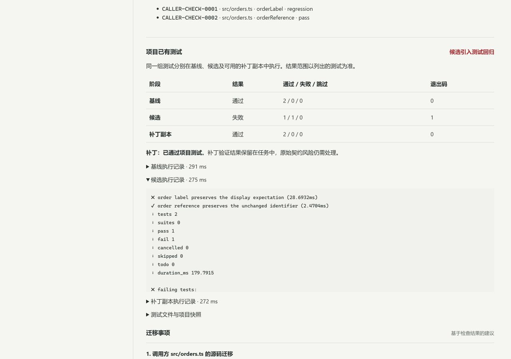

# ContractGuard v1.8.0 — Connect API change reviews to your existing tests

*Local GitHub Release draft; not yet published. Source links and the checkout command below require the source and `v1.8.0` tag to be published first.*

An API renames `customerName` to `displayName`. Can the old client still display an order? Once you find the affected code, does the proposed change pass its existing tests?

**ContractGuard 1.8 brings contract changes, caller source, existing tests, and patch verification into one review record.** Register a local project once, then select it in the web application or through an agent. See contract risks, source locations for supported callsites, and actual test outcomes against baseline responses, candidate responses, and a patched source copy. Keep the evidence available for migration decisions and later review.

## What is new

- **Use existing tests to check an API migration.** Run selected Node.js or Vitest test files and retain separate baseline, candidate, and patched outcomes. Distinguish a new regression from an already failing baseline or an inconclusive run.
- **Reuse project inputs.** A registry connects contracts, caller source, response fixtures, and test files. Each review reads a single local snapshot; web and MCP requests select a registered project instead of repeatedly submitting source and response bodies.
- **Follow a finding through to a verified change.** Supported TypeScript callsites include file, line, column, and field-access locations. With an explicit semantic field mapping, a proposed rename can undergo bounded AST replay and then existing tests in a source copy. The original risks and release gate remain visible alongside patch verification.
- **Let DeepSeek plan the review.** Optional LLM orchestration selects permitted checks and returns recommendations linked to evidence. It must complete contract validation, official oasdiff checks, native analysis, and any required caller and project checks before finishing. The fixed `workflow` mode requires no model.
- **Share the record between people and agents.** Follow progress, cancel tasks, open linked caller reports, revisit history, and export complete reports. Snapshot fingerprints, test identities, execution results, and coverage limitations stay with the review.



## Try the order migration

Requirements: **Node.js 22.13+**, **pnpm 11.19.0**, and Git. In Windows PowerShell:

```powershell
git clone --branch v1.8.0 https://github.com/Reizen721/ContractGuard.git
cd ContractGuard
pnpm install --frozen-lockfile
pnpm engine:install
pnpm build
.\start-contractguard.bat --projects .\fixtures\project-tests\demo-registry.json --no-ai
```

Open `http://127.0.0.1:8080/`. Select **Agent 审查 → 已登记项目与测试 → 订单字段迁移与已有测试**, then **开始审查**. The bundled example requires no model key.

| Phase | Expected result |
| --- | --- |
| Original code + baseline responses | 2 tests pass |
| Original code + candidate responses | 1 passes and 1 fails, reproducing the order-display regression |
| Patched source copy + candidate responses | 2 tests pass; patch status is `verified` |
| Original release verdict | `blocked`, preserving the risks in the original inputs |

Open **查看源码位置与补丁** to inspect the linked caller evidence. The blocked verdict is expected: successful patch verification does not clear the gate for the original code.

If you already have a server-side DeepSeek profile, restart without `--no-ai` and explicitly select **LLM 自主编排**. Credentials remain server-managed; do not place them in the project registry or MCP arguments.

To use your own project, register trusted source files, selected tests, and response fixtures. Required dependencies must already be installed. See the [V1.8 guide](https://github.com/Reizen721/ContractGuard/blob/v1.8.0/docs/v1.8-project-agent.md) for the registry format, CLI usage, and execution boundaries.

## Use it from an agent

After upgrading and building, run `pnpm plugin:prepare`, restart the API, and reload the plugin in your host. The plugin connects to the same local service; installing it alone does not start that service. See the [plugin guide](https://github.com/Reizen721/ContractGuard/blob/v1.8.0/docs/v1.6-agent-plugin.md) for setup.

Try this prompt in a connected agent:

> List the projects registered with ContractGuard. Review orders-migration in workflow mode and wait for all required checks. Explain contract risks, caller replay, project tests, and patch verification separately. Open the linked caller record and export the complete Markdown report. Preserve unknown coverage and the original release gate.

## Verification

Local Windows validation completed on 2026-11-02, including a successful full `pnpm check`: **481 unit/component tests passed and 2 were skipped**. Both skips concern Windows file-symlink permissions. Automated regressions cover builds, type checks, existing functionality, real MCP/HTTP tool execution, project subprocesses, history recovery, and report export. Routine model-orchestration tests use controlled responses.

A live **DeepSeek `deepseek-flash`** rerun through the official API passed **all eight acceptance checks** for the order migration. It completed all seven required checks. Actual project execution produced two baseline passes, one candidate pass and one failure, and two passes with the patch. Evidence references in all three model recommendations passed validation; pagination, full export, and MCP reconnection preserved the report. A model-free `workflow` control used identical input fingerprints and reached the same deterministic results. Both retained the original `blocked` gate, and original project files were unchanged.

This round corrected the planner's tool-purpose guidance and repeated live acceptance afterward. Valid references do not establish the accuracy of every sentence: the final report still described a patch that passed project tests as having only bounded replay verification. That wording is recorded for human review. Use structured execution evidence to assess results, and review model recommendations before acting. See the [live DeepSeek acceptance record](https://github.com/Reizen721/ContractGuard/blob/v1.8.0/docs/v1.8-deepseek-acceptance.md) for the complete sequence.

Public-project verification reused five existing GET tests from a pinned **openapi-fetch** revision. All six predefined response conditions matched expectations, including a behavior change with an unchanged contract and a changed route that the selected tests never visited. This is a controlled mutation experiment on one open-source library, not the full upstream suite or a production-accuracy measurement.

Actual web checks covered project selection, three-phase results, linked caller and patch views, complete JSON download, history after refresh, and desktop and narrow layouts. See the [verification record](https://github.com/Reizen721/ContractGuard/blob/v1.8.0/docs/verification.md) and [public-project methodology](https://github.com/Reizen721/ContractGuard/blob/v1.8.0/docs/v1.8-benchmark.md) for evidence, retained failures, and limits. This round did not add validation on other operating systems, Docker, or remote CI.

## Scope

Project tests run only for explicitly registered, trusted projects. They execute in temporary source copies, but a normal subprocess **is not an operating-system security sandbox** and can still access other local resources or the network. ContractGuard does not install dependencies or write proposed patches back to the original project.

Caller replay supports bounded TypeScript syntax; project execution covers the selected files and supplied response conditions. Missing scenarios, unsupported wrappers, and incomplete checks remain visible as unknowns. Passing a selected test set does not establish production compatibility.

The built-in planner receives bounded check summaries, without raw source, response bodies, complete patches, or raw test output. Material read by an external cloud agent and MCP tool results may still enter that host's model service. Deterministic contract checks continue to combine official **oasdiff 1.35.0** with native rules; see [third-party notices](https://github.com/Reizen721/ContractGuard/blob/v1.8.0/THIRD_PARTY_NOTICES.md) for attribution and licensing.
