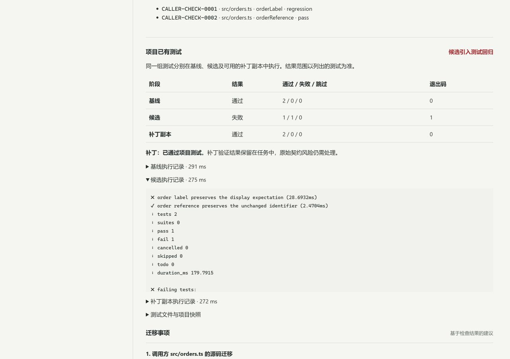

# ContractGuard v1.8.0 — 把 API 变更审查连到项目已有测试

*GitHub Release 本地草稿，尚未发布。下文使用 `v1.8.0` 的源码链接和克隆命令，需要对应源码与标签发布后才可使用。*

API 把 `customerName` 改成 `displayName`，旧调用方还能正常显示订单吗？找到受影响的代码后，提出的改法能否通过原有测试？

**ContractGuard 1.8 把契约变更、调用方源码、已有测试和补丁复验放进同一条审查记录。** 登记一次本地项目后，在网页或 Agent 中选择项目，即可查看契约风险、已支持调用点的源码位置，以及选定测试在基线、候选和补丁副本下的实际结果。团队可以沿着证据判断哪里需要迁移、改法验证到了哪里，并在后续会话继续查看同一份报告。

## 本次更新

- **让已有测试参与 API 迁移。** 使用 Node.js 或 Vitest 实际执行选定测试文件，分别记录基线、候选与补丁阶段。基线本来失败、候选引入回归、测试证据不足会得到不同结果，便于判断下一步该修代码还是补材料。
- **减少重复整理输入。** 项目注册表关联契约、调用方源码、响应 fixture 和测试文件；每次审查从同一份本地快照读取材料。网页和 MCP 只需选择已登记的项目，不必反复粘贴源码与响应正文。
- **从发现问题继续验证改法。** 支持的 TypeScript 调用点保留文件、行列与字段访问位置；确认字段语义映射后，候选改名补丁先通过有限 AST 重放，再交给项目已有测试在副本中复验。原始风险和发布门禁仍然保留，便于区分“这个改法已验证”和“当前版本可以发布”。
- **DeepSeek 可以推进完整审查。** 可选的 LLM 编排会选择允许的检查步骤，关联证据并提出迁移建议。契约校验、官方 oasdiff 检查、原生分析，以及提交材料所要求的调用方和项目测试，均须完成后才能结束。无需模型时，`workflow` 提供固定流程。
- **网页与 Agent 共享审查过程。** 查看进度、取消任务、打开关联调用方记录、查询历史和导出完整报告，都围绕同一条任务。快照指纹、测试身份、执行结果和未覆盖范围随报告保留，方便复核与交接。



## 跑一次订单迁移

需要 **Node.js 22.13+、pnpm 11.19.0 和 Git**。在 Windows PowerShell 中执行：

```powershell
git clone --branch v1.8.0 https://github.com/Reizen721/ContractGuard.git
cd ContractGuard
pnpm install --frozen-lockfile
pnpm engine:install
pnpm build
.\start-contractguard.bat --projects .\fixtures\project-tests\demo-registry.json --no-ai
```

打开 `http://127.0.0.1:8080/`，选择 **Agent 审查 → 材料来源：已登记项目与测试 → 订单字段迁移与已有测试**，点击“开始审查”。演示无需模型 Key。

| 阶段 | 演示中应看到的结果 |
| --- | --- |
| 原代码 + 基线响应 | 2 项测试通过 |
| 原代码 + 候选响应 | 1 项通过、1 项失败，复现订单显示回归 |
| 补丁副本 + 候选响应 | 2 项测试通过，补丁标记为 `verified` |
| 原始发布结论 | `blocked`，保留尚未迁移的原始风险 |

通过“查看源码位置与补丁”继续追查调用方证据。这个阻断结果符合演示预期；补丁验证成功不会替原始输入解除门禁。

已有 DeepSeek 服务端配置的用户可以移除 `--no-ai` 重启，再明确选择 **LLM 自主编排**。密钥由服务端管理，不填入项目注册表或 MCP 参数。

将自己的项目接入时，先登记可信源码、选定测试和响应 fixture；已有依赖需提前安装。完整注册示例、CLI 用法与执行边界见 [V1.8 使用指南](https://github.com/Reizen721/ContractGuard/blob/v1.8.0/docs/v1.8-project-agent.md)。

## 在 Agent 中使用

升级源码并构建后运行 `pnpm plugin:prepare`，重启 API，并重新加载宿主中的插件。插件连接同一个本机服务；安装插件本身不会启动服务。接入步骤见[插件指南](https://github.com/Reizen721/ContractGuard/blob/v1.8.0/docs/v1.6-agent-plugin.md)。

可以直接向已连接的 Agent 提出：

> 查询 ContractGuard 已登记项目，用 workflow 审查 orders-migration，等待所有必要检查完成。分别说明契约风险、调用方重放、项目测试和补丁复验结果；打开关联调用方记录，导出完整 Markdown 报告，保留未知范围和原始发布门禁。

## 已完成的验证

2026-11-02 在 Windows 本机完成验证，完整 `pnpm check` 通过，其中单元和组件测试 **481 项通过、2 项跳过**。两项跳过均与 Windows 文件符号链接权限有关。自动化回归覆盖构建、类型检查、既有功能、MCP/HTTP 真实工具链、项目子进程、历史恢复与报告导出；其中常规模型调度测试使用受控响应。

本版通过官方 API 使用真实 **DeepSeek `deepseek-flash`** 重跑订单迁移审查，**8/8 验收点通过**。模型完成全部七项必要检查；实际项目测试得到基线 2 项通过、候选 1 项通过与 1 项失败、补丁 2 项通过。三条模型建议引用的证据均通过有效性检查，分页、完整导出和 MCP 重连保留同一结果。另跑无模型 `workflow` 后，输入指纹与确定性结果一致；两个任务均保留原始 `blocked` 门禁，原项目文件未改变。

本轮修正了模型工具用途说明，并在修正后重新完成真实模型验收。引用有效不代表模型自由文本的每句话均准确：最终报告仍有一处将已通过项目测试的补丁描述为“仅有限重放”，已记录为需人工确认的文字问题。审查应以结构化执行证据为准，模型建议仍需人工审阅。完整过程见[真实 DeepSeek 验收记录](https://github.com/Reizen721/ContractGuard/blob/v1.8.0/docs/v1.8-deepseek-acceptance.md)。

公开项目验证复用了固定版本 **openapi-fetch** 的五项已有 GET 测试。六种预先定义的响应条件全部符合预期，包含契约未变但已有断言失败的情况，以及测试未访问变更路径的情况。这是一个开源库上的受控变异实验；未执行上游完整套件，也不代表生产准确率。

网页已实际检查项目选择、三阶段结果、源码与补丁跳转、完整 JSON 下载、刷新后的历史恢复，以及桌面与窄屏布局。完整方法、失败记录和验证范围见[验证记录](https://github.com/Reizen721/ContractGuard/blob/v1.8.0/docs/verification.md)与[公开项目验证说明](https://github.com/Reizen721/ContractGuard/blob/v1.8.0/docs/v1.8-benchmark.md)。本轮未新增其他操作系统、Docker 或远程 CI 验收。

## 使用范围

项目测试只对明确登记为可信的项目运行。测试在临时源码副本中执行，普通子进程**不是操作系统安全沙箱**，仍可能访问其他本机资源或网络。ContractGuard 不自动安装依赖，也不把补丁写回原项目。

调用方重放支持有限的 TypeScript 语法；项目测试仅覆盖选定文件和提供的响应条件。缺少场景、不支持的封装和未完成的检查会保留为未知范围，有限测试通过不等于生产兼容性保证。

内置规划模型接收有界检查摘要，不接收原始源码、响应正文、完整补丁或原始测试输出；外部云端 Agent 读取的材料和 MCP 返回仍可能进入该宿主的模型服务。确定性契约检查继续结合官方 **oasdiff 1.35.0** 与原生规则，来源和授权见[第三方声明](https://github.com/Reizen721/ContractGuard/blob/v1.8.0/THIRD_PARTY_NOTICES.md)。
