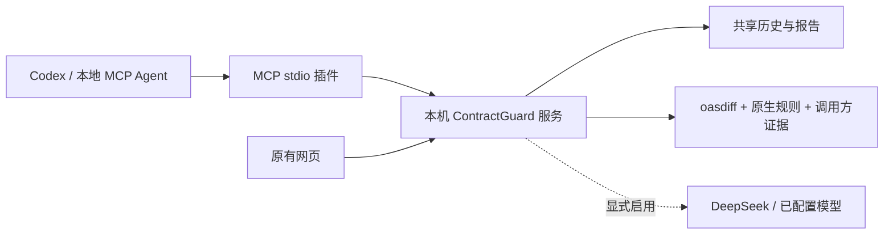

# V1.6：把 ContractGuard 接入 Agent

本文记录 V1.6 的 14 项工具与接入基线。V1.7 增加 4 项调用方迁移工具，V1.8 再增加项目发现，共 19 项；当前版本、项目测试和升级步骤见 [V1.8 指南](v1.8-project-agent.md)。下列历史验收版本不代表最新宿主兼容性承诺。

本地交付日期：2026-11-02。插件版本 1.6.0，原生分析引擎仍为 1.5.0，官方 oasdiff 固定为 1.35.0。本次增加接入层，保留已有网页、CLI、规则、回归包和模型配置。

## 1. 装上以后能做什么

在支持本地 MCP 的 Agent 中，可以直接要求：

> 用 ContractGuard 审查这次 API 升级，检查我提供的调用方样例；列出会受影响的客户端、证据和迁移建议，再保存一份报告。

Agent 读取你授权的文件，通过插件提交给本机 ContractGuard，随后查询进度和证据。分析与审查会出现在原来的网页历史中。也可以反过来，让 Agent 查阅你之前在网页保存的报告。

这里有两个不同的模型角色：外部 Agent（例如 Codex）负责理解你的任务、读取授权文件、调用插件并整理答复；ContractGuard 内置的 DeepSeek 是可选的报告解释器或受控规划模型。外部 Agent 完全可以用自己的模型调用 `workflow`，完成全部确定性检查，不必再调用 DeepSeek。只有显式选择 `llm` 或生成 AI 解读，才使用服务端配置的模型。



## 2. 安装前提与兼容范围

- 本机安装 Node.js 22.13 或以上版本，已有 ContractGuard 源码与依赖。
- ContractGuard 服务与插件运行在能访问同一个回环地址的环境。WSL、容器、远程开发机中的 `127.0.0.1` 可能不是 Windows 主机，请在同一环境部署，或建立自己管理的本地端口转发。
- 通用接入面是 **MCP stdio**。支持该协议且能启动本地进程的宿主可配置使用；已打包 portable Agent Plugin 与 Codex 兼容清单。不能据此宣称所有宿主、所有版本均已实测。
- 仅支持远程 HTTP MCP 的云端 Agent 不能直接连接这个本地插件。本版没有 `/mcp` 公网入口，也不替无鉴权的 API 建立公网隧道。

Codex 的配置与插件包装依据 [官方 MCP 文档](https://developers.openai.com/codex/mcp)、[插件包装文档](https://developers.openai.com/plugins/build/plugins)及[桌面插件文档](https://developers.openai.com/plugins/deploy/desktop-only)。MCP 实现使用[官方 TypeScript SDK](https://github.com/modelcontextprotocol/typescript-sdk)。

## 3. 生成可用插件

在 ContractGuard 项目目录运行：

```powershell
pnpm install --frozen-lockfile
pnpm build
pnpm plugin:prepare
```

生成位置：

```text
.tools/agent-plugin/
  mcp-config.json                  通用 MCP 客户端配置，含本机绝对路径
  codex-config.toml                Codex 配置片段，含 180 秒工具超时
  antigravity-mcp.json             Antigravity MCP 配置片段
  deepseek-harness.cordis.json     Harness Cordis overlay 的 insert 配置片段
  .agents/plugins/marketplace.json 本地插件目录
  plugins/contractguard/
    plugin.json                   portable 插件清单
    mcp.json                      portable MCP 声明
    .codex-plugin/plugin.json     Codex 兼容清单
    .mcp.json                     兼容 MCP 声明
    skills/contractguard/         Agent 使用说明
    server/index.cjs              已打包运行代码，包含所需 JS 依赖
    LICENSE
    THIRD_PARTY_LICENSES.md
```

默认只生成上述文件，不改变宿主的全局配置。输出已被 Git 忽略；不含本机历史、API Key 或原始业务材料。源码中的 `plugins/contractguard/` 是打包模板，尚未带入运行文件；**应导入生成后的插件目录**。

换端口或指定输出位置时：

```powershell
node scripts/install-agent-plugin.mjs --api-url http://127.0.0.1:8090 --output "C:\ContractGuard Plugin"
```

目标目录必须为空或属于本生成器；不会清空已有无关文件。可移动的是 `plugins/contractguard/` 内完整插件；根部 JSON/TOML 是针对当前机器生成的绝对路径配置，搬家后需要重新生成或修改路径。插件本身仍依赖 Node 和独立启动的 ContractGuard API 服务，不包含整个分析平台或 oasdiff 二进制。

## 4. 接入 Codex

优先使用生成的 `codex-config.toml`，把其中 `[mcp_servers.contractguard]` 和对应 `.env` 小节合并到 Codex 的配置中，不覆盖其他设置。配置中的 `command` 是实际 Node 路径，`args` 指向生成后的运行文件。不要把 DeepSeek Key 写入配置。

也可显式调用安装脚本注册 MCP 服务：

```powershell
node scripts/install-agent-plugin.mjs --codex
```

该选项会调用本机 Codex CLI。已有同名但配置不同的条目会被保留并提示人工核对。CLI 注册方式只安装 MCP 工具，不自动安装 skill；工具初始化时仍会提供完整使用说明。若 CLI 不能设置超时，请合并生成片段中的 `tool_timeout_sec = 180`，避免同步 AI 解读被宿主默认超时中断。

支持本地插件目录的 Codex 版本还可安装完整插件与 skill：

```powershell
codex plugin marketplace add ./.tools/agent-plugin
codex plugin add contractguard@contractguard-local
```

具体入口以安装的 Codex 版本为准；插件目录方式与直接 MCP 配置选择一种即可，重复安装会出现重复工具。安装后打开新对话或按宿主要求重新加载。当前对话不会因为生成了文件就自动获得新工具。

本地目录必须保留开头的 `./`（或使用绝对路径）；省略时，一些 Codex 版本会把它当成 GitHub 仓库名称。

## 5. 接入其他 Agent

将生成的 `mcp-config.json` 中 `mcpServers.contractguard` 合并到宿主的 MCP 配置。常见结构如下，示例路径需要替换为生成器输出的实际路径：

```json
{
  "mcpServers": {
    "contractguard": {
      "command": "node",
      "args": ["C:/ContractGuard Plugin/plugins/contractguard/server/index.cjs"],
      "env": { "CONTRACTGUARD_API_URL": "http://127.0.0.1:8080" }
    }
  }
}
```

不同宿主的配置外层、超时和工具审批机制可能不同，应按各自说明合并。`args` 中每个值是一个独立参数，路径含空格时也不要额外嵌入引号。不要配置 `pnpm mcp` 为协议命令；生成配置直接运行 Node，保证 stdout 只有 MCP 消息。

自己开发的 Agent 可以通过标准 MCP 客户端执行 `initialize → tools/list → tools/call`。如果框架只支持自定义函数调用，需要自行把这些工具转为框架函数；本版不提供所有框架的专用 SDK。

### Antigravity App

本机已按 [Antigravity 官方 MCP 配置](https://antigravity.google/docs/mcp)接入。其他机器可把生成的 `antigravity-mcp.json` 中 `mcpServers.contractguard` 合并进 `~/.gemini/config/mcp_config.json`，保留原来的其他服务。生成片段含当前机器的绝对 Node/runtime 路径和 240 秒工具超时。

在本次 App 2.28.2 验收中，仅重新打开 Customizations 列表未加载新增条目；正常退出并重开应用后，真实 Gemini 模型成功开始调用插件。因此首次配置后若看不到服务，先保存未发送输入并正常重启应用，再开新会话测试。不要为此删除或重启无关的 MCP 服务。

### DeepSeek Harness

Harness 使用 [官方 MCP / Cordis overlay 配置](https://deepseek-harness.github.io/deepseek-harness/en/guide/mcp-memory)。本次桌面版 0.2.1-rc.5 的配置位置是 `~/.dsh/profiles/desktop/cordis.patch.yml`，服务插件为 `@deepseek-ai/dsh-mcp-client`。将生成的 `deepseek-harness.cordis.json` 内的 `insert` 项合并进已有 overlay 数组，保留已有模型与其他设置；不能把两个 JSON 文件文本直接串接或用片段覆盖原配置。

生成项只包含 `serverName: contractguard`、`transport: stdio`、运行路径、本机 API 地址和超时，不含模型账号或 Key。该桌面版本可加载新增配置；开启一个新会话即可验收。独立 headless CLI 的登录状态与桌面未必共享，本次 CLI 返回 `ACCOUNT_SIGN_IN_REQUIRED`，随后在已登录的桌面会话完成真实调用；没有复制任何登录凭据。

### 本机宿主验收口径

“MCP 协议能连接”“宿主已安装”“真实模型已调用”是三层不同验证。本次在三款宿主中分别测试状态、创建合成分析、按返回 ID 查询详情和查看历史，详情见 [验证记录](verification.md)。Codex alpha 版本在一次完整成功后，重复测试出现动态工具已发现但 JavaScript 调用映射缺失的问题，不能把成功一次描述为该宿主版本每次都稳定；遇到此问题不要用虚构结果继续回答，也不要无限重试创建操作。

后续的[Codex 十案例测试](v1.6-codex-ten-cases.md)使用官方 `features.code_mode.direct_only_tool_namespaces` 配置，临时让 ContractGuard 直接调用，保持代码执行桥接开启。脚本中保留该配置及真实工具事件核验；不修改全局设置。直接关闭 `code_mode_host` 会导致当前模型报桥接已禁用，不应当作这个版本的解决方法。

## 6. 第一次完整运行

先用原来的方式启动服务：

```powershell
.\start-contractguard.bat
```

如需 DeepSeek，在启动窗口的隐藏提示中填写 Key。插件只访问服务的状态和工具接口，不读取或传递 Key。不开 AI 时可用 `--no-ai`，本地分析和 `workflow` 仍然工作。已有服务正在运行时，无需为了使用插件再启动一个进程。

安装插件后，把下面内容发给 Agent：

> 先调用 ContractGuard 状态工具。读取这个仓库的 `fixtures/consumer-impact/baseline.json`、`candidate.json` 和 `consumers.json`，使用其中真实内容创建普通分析，再以 workflow 模式启动完整审查。等待完成，列出确定性结论、上游风险、调用方回归和迁移建议。查历史确认两条记录已保存；导出审查 Markdown 到我当前项目的 `contractguard-review.md`。不要把执行完成说成发布通过。

这组零凭据的合成零售样例在当前引擎下应得到 `blocked`、2 条上游 breaking、3 项调用方回归。历史查询应能找到返回的分析 ID 与任务 ID；网页的普通分析历史和 Agent 历史是两类记录。

希望复用已经配置的 DeepSeek 时，可明确要求：

> 使用相同材料，以 llm 模式、deepseek-cloud 档案运行 ContractGuard 审查。先确认档案可用，完成后保留原始门禁结论，展示模型规划调用次数、工具步骤及引用证据的迁移建议。

如果你的活动档案名称不同，使用状态工具返回的实际 ID，或不传 `providerId` 使用活动档案。AI 解读面向已保存的普通分析；传 `analysisId`，默认复用相同配置下的已保存解读，只有明确需要重新生成时才传 `force: true`。

## 7. 工具清单

所有名称均以 `contractguard_` 开头；工具调用字段由 MCP 的 `tools/list` 实时给出，不需要 Agent 猜 REST 路径。

| 工具后缀 | 用途 | 主要输入 |
| --- | --- | --- |
| `status` | 服务、引擎、模型可用性 | 空对象 |
| `rules` | 原生规则目录，区别于上游目录 | `offset, limit` |
| `analyze` | 创建并保存原生分析与可选调用方检查 | `baseline, candidate, consumerEvidence?` |
| `get_analysis` | 摘要或逐页证据 | `analysisId, section, offset, limit` |
| `list_analyses` | 普通分析历史 | `offset, limit` |
| `export_analysis` | 完整 JSON / Markdown / HTML | `analysisId, format, offset, maxCharacters` |
| `explain_analysis` | 生成并保存 AI 解读 | `analysisId, language?, focus?, providerId?, force?` |
| `list_explanations` | 查询已保存的解读，不调用模型 | `analysisId, offset, limit` |
| `export_explanation` | 读取指定解读 JSON / Markdown | `analysisId, reviewId, format, offset, maxCharacters` |
| `start_review` | 排队执行完整审查 | 分析输入及 `mode?, goal?, providerId?` |
| `get_review` | 轮询进度或查询审查证据 | `runId, section, offset, limit` |
| `list_reviews` | 完整审查历史 | `offset, limit` |
| `cancel_review` | 取消指定任务，保留已有记录 | `runId` |
| `export_review` | 读取完整审查 JSON / Markdown | `runId, format, offset, maxCharacters` |

`get_analysis.section` 可选 `overview / changes / consumerChecks / coverageWarnings / migrationTasks`。`get_review.section` 可选 `overview / steps / findings / nativeChanges / consumerChecks / recommendations / limitations`。默认查询摘要，详情每页默认 20 项、最多 50 项；历史也通过 `nextOffset` 翻页。

两侧契约接受 YAML/JSON 文本、对象或显式文件包 `{kind:"bundle", entry, files:[{path,content}]}`。文件包每侧最多 50 文件、5 MiB；样例证据继续遵守 1 MiB 等原有限制。插件不读取服务端磁盘路径，不下载契约内的远程引用。

导出返回 `{content, offset, totalCharacters, nextOffset}` 等字段。偏移是 UTF-16 索引，直接使用返回的 `nextOffset` 续取并按顺序拼接 `content`；不能仅保存第一块就称完整报告。每块默认 24,000 字符、最多 32,000 字符。审查任务应到终态后再导出，运行中的报告可能继续变化。

后台任务的 `completed` 是执行完成，不等于 `pass`；`failed / cancelled / interrupted` 也不是成功评审。插件进程关闭或某次查询取消，不会取消服务端已经排队的任务，必须调用取消工具。

## 8. 保留的能力与实际边界

- 原有网页与 CLI 不替换；多文件、方言规范化、coverage、调用方样例、AI 证据校验、历史恢复、报告导出继续由现有实现处理。
- 插件查询和网页同一 HTTP 服务，因此记录 ID、确定性得分、门禁和已保存 AI 内容一致。离线 CLI 使用自己的文件输出或任务目录，不会自动同步进网页历史。
- 普通分析调用原生规则；完整审查组合上游与原生检查，二者不承诺风险条数相同。已有自定义 `rulePolicy` 只作用于普通 HTTP 分析，Agent 原生步骤使用默认策略，此次没有改变该边界。
- 官方 oasdiff 完整 CLI 仍可通过 `contractguard oasdiff …` 使用；插件审查采用受限检查集合，不把任意命令和联网参数暴露给模型。删除历史仍在原网页/API，未新增自动删除工具。
- API 地址由安装者固定为回环 HTTP，工具参数不能改变地址。HTTP 响应最多 16 MiB，单次工具数据最多 256 KiB；超限明确报错，不默默省略风险。旧 HTTP 列表尚无服务端分页，插件先有界获取再切片，因此异常大的历史应通过网页处理。
- 创建和启动请求不会自动重试。若连接中断或超时，应先查历史，防止重复任务与额外模型费用。
- DeepSeek 的凭据与最小化输入机制保持原样。但外部 Agent 能看到它读取的契约和插件返回的数据，可能交给自己的云端模型；这属于宿主自己的数据边界，不能套用 ContractGuard 内置解释器的最小化保证。
- 标准 `readOnlyHint` 等标注帮助宿主决定是否确认，不替宿主实施权限控制。描述、示例、报告里的文字均是待分析数据，不能授予执行代码、读取密钥或上传资料的权限。

## 9. 验证与排错

```powershell
pnpm check
pnpm regression:v16
pnpm test:plugin
```

完整检查保留以往所有回归。新增检查覆盖 MCP 协议、实际 HTTP/核心引擎/oasdiff、模拟模型生成与保存、服务重启后读取、取消传播、插件搬迁和配置不覆盖。实际执行结果及未验证项见 [验证记录](verification.md)。

| 现象 | 处理 |
| --- | --- |
| MCP 工具能发现，但状态报 `API_UNREACHABLE` | 启动原服务，确认端口与插件配置一致；检查是否处于不同容器/WSL 环境 |
| 找不到 Node 或 runtime | 使用生成器给出的绝对路径；导入生成目录，不是源码模板 |
| 确定性分析可用、AI 不可用 | 在原启动窗口安全输入 Key 并检查活动档案；不在聊天或 MCP 中提交 Key |
| AI 解读被宿主提前取消 | 使用 180 秒工具超时；先查已保存解读，再决定是否重试 |
| 返回 `TOOL_RESULT_TOO_LARGE` | 缩小分页数量，或通过分块导出读取完整内容 |
| 审查已完成但结论 `blocked/review` | 阅读 findings、consumerChecks 与 limitations；不能将任务完成等同于可发布 |
| 插件工具出现两套 | 保留完整插件安装或直接 MCP 注册中的一种 |

本地生成和测试完成不等于已发布 npm 包、公共插件市场或已在所有宿主中安装。当前也没有自动提交或推送 GitHub。
