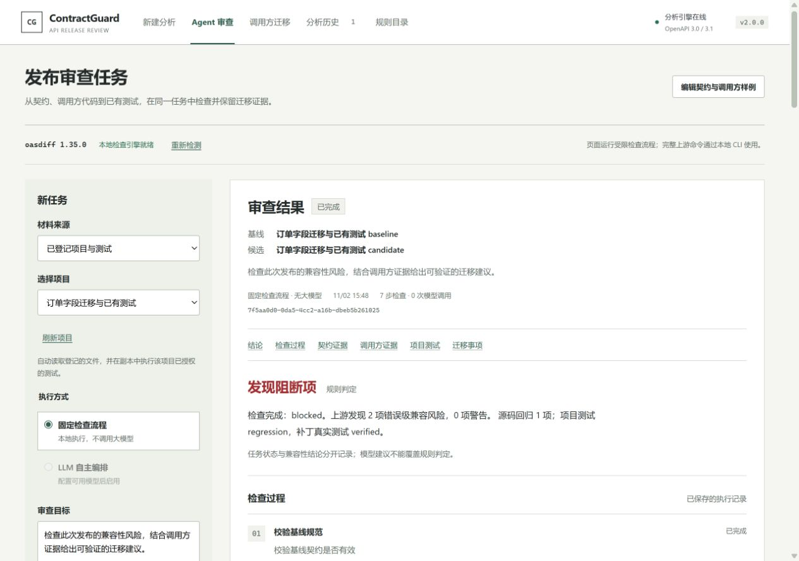

# ContractGuard 2.0 发布验证

日期：2026-11-02（Asia/Shanghai）。本记录区分本次 2.0 实际执行的验证与先前版本的云端模型验证；发布与远程 CI 状态以 [GitHub Releases](https://github.com/Reizen721/ContractGuard/releases/tag/v2.0.0) 和 [GitHub Actions](https://github.com/Reizen721/ContractGuard/actions/workflows/ci.yml) 为准。

## 环境与版本

- Windows，Node.js 24.21.0，pnpm 11.19.0。
- 根包、8 个工作区包、core/caller/MCP 运行版本、两份插件清单与启动器统一为 **2.0.0**。
- 固定上游 oasdiff 为 **1.35.0**，第三方 fixture、历史记录的原始版本不改写；`schemaVersion: 1` 保持不变。
- 新增 `versions:check` 和 `regression:v20`，纳入默认检查链。

## 自动化与升级检查

| 范围 | 本次结果 |
| --- | --- |
| 构建与类型检查 | 全部通过 |
| Core / oasdiff / Caller / Project | 205 / 13 / 21 / 13 项通过 |
| API / CLI / Web / MCP | 105 / 23 / 77 / 26 项通过 |
| 单元与组件合计 | **483 通过、2 跳过**；跳过项是本机 Windows 文件符号链接权限相关测试 |
| 2.0 升级集成 | **9/9**；版本声明、旧回归包、旧历史读取/列表/导出、磁盘字节保留 |
| 插件包装 | **7/7**；包含可移动运行、许可与配置边界 |
| 默认回归链 | smoke、既有 regression、V1.3 回归/20 顺序案例/8 复杂场景、V1.4–V1.8 回归与 51 项 oasdiff 透传对照全部通过 |
| 文档与配置 | 文档链接、示例配置、版本一致性检查通过 |
| Codex 隔离安装 | 临时 marketplace 安装、幂等注册、真实 stdio 握手与 **19 个工具**通过；CLI 0.166.0-alpha.5.1；未修改用户真实配置或调用模型 |
| Windows 启动自检 | `start-contractguard.bat --check --projects fixtures/project-tests/demo-registry.json --no-ai` 退出 0，识别 1 个登记项目，无密钥输入 |

旧版 1.5.0 回归包通过明确白名单重放，原包版本、输入和 SHA 校验保持不变，新结果标记 2.0.0。篡改输入、未知引擎版本仍拒绝。旧分析、调用方及 Agent 历史用合成升级 fixture 验证，读取和导出不会改变磁盘文件；这不是任意未来格式的兼容承诺。

本地默认检查链分两段完成：首次 `pnpm check` 已通过构建、类型与全部单元测试，随后因并行撰写中的新文档尚未落盘而在文档链接检查停止。文档完成后重新执行 `docs:check`，并按相同顺序执行剩余配置、版本、冒烟与全部回归命令，均退出 0；没有把首次命令的退出码记成成功。完整单命令检查由本次提交的 GitHub CI 再执行，状态可沿上方 Actions 链接核验。

本机复验日志位于仓库旁 `ContractGuard-v2-check.log`、`ContractGuard-v2-regressions.log`、`ContractGuard-v2-benchmark.log`、`ContractGuard-v2-plugin.log`，不作为源码发布。

## 实际页面验收

通过 computer-use 在独立服务 `http://127.0.0.1:18084/` 操作，使用单独历史目录与关闭 AI 的配置，未读取密钥或停止用户原有 18083 服务。

1. 载入 Campus Events 演示并运行分析：得到 7 项破坏性变更、3 项风险、1 项兼容变更，成功保存到历史。
2. 选择已登记的订单项目并提交固定流程：任务 `7f5aa0d0-0da5-4cc2-a16b-dbeb5b261025` 完成 **7 步检查、0 次模型调用**。
3. 三阶段真实测试为 **基线 2 通过 → 候选 1 通过 / 1 失败 → 补丁 2 通过**；原始规则结论保留 `blocked`。
4. 报告目录可跳到项目测试；“查看源码位置与补丁”打开关联调用方记录 `e39ffeb0-ade0-41e6-8fdb-6a97b51f8f45`，显示字段位置、候选失败原因与已验证补丁。
5. 分析历史可重新打开只读报告；返回 Agent 后任务记录保留。
6. 在 1280×900、663×900、390×844 检查实际布局。中等宽度与手机整页滚动宽度分别为 648、375，均未超出内容视口；表格和移动端导航可在自身区域滚动。检查后恢复默认视口。未捕获 console error/warn。

界面保留灰白绿色工作台样式，改善版本输入头、报告目录、任务与门禁状态、三阶段测试行和响应式布局。独立审查实际查看四张截图与相关源码，未发现发布阻断级 UX 问题。

本次唯一设计检测对 6 个 Vue/CSS 文件报告 **0 个 anti-pattern、382 条 advisory**。其中包含既有样式的字面量颜色和字体规格提示；此结果仅来自静态正则扫描，不代表完整无障碍审计。未为消除提示而批量重写设计系统。



截图另见：[契约输入](assets/v2.0-workbench.png)、[项目测试](assets/v2.0-project-tests.png)、[中等宽度](assets/v2.0-agent-tablet.png)、[手机测试结果](assets/v2.0-agent-mobile.png)。

## 真实项目回归

在 2.0 代码下重新运行 `pnpm benchmark:v18`，**6/6 条件符合预期**：正常对照、字段改名、状态改变、仅行为改变、非法基线、未覆盖路由。脚本名称保留原验证系列名称。

独立 Vitest 与 Agent 执行的阶段计数、退出码一致，五项上游 GET 测试及运行库未修改；每条路径各执行 60 次测试，56 次通过、4 次为设计中的失败。数据来自固定提交的 openapi-fetch 与受控 provider 变化，不是上游历史事故、完整上游套件或市场准确率测评。[来源、适配与边界](v1.8-benchmark.md)。

## 发布附件

`ContractGuard-Agent-Plugin-2.0.0.zip`：252,122 字节，9 个白名单文件，包括隐藏插件清单、MCP 配置、打包后的 Node.js 服务入口、skill 与许可证。逐项验证归档内容与准备目录 SHA-256 一致，两份 manifest 均为 2.0.0。

SHA-256：

```text
17528219b3e35fe86bcb1768047267f499bf038966180fd54006d6d57e115cd8
```

附件不包含密钥、本机配置、历史记录、node_modules 或上游引擎二进制。它需要 Node.js 与已经启动的 ContractGuard API；完整源码由仓库和 GitHub 自动源码归档提供。配置和运行步骤见 [2.0 使用指南](v2.0-user-guide.md)。

## 验证边界

本次发布没有新增付费云端模型调用。此前真实 DeepSeek 的完整订单流程、重试次数及模型文字质量限制保留在 [V1.8 专项验收](v1.8-deepseek-acceptance.md)，不将其改称 2.0 新实测。2.0 的模型接口回归使用受控模型响应与真实本地工具。

项目测试是普通 Node 子进程执行可信代码，并非操作系统安全沙箱。字段迁移仍依赖显式映射，选定测试通过不能证明任意调用方兼容。本机未验证 Docker 构建，也未新增 Antigravity/Harness 宿主模型测试。
