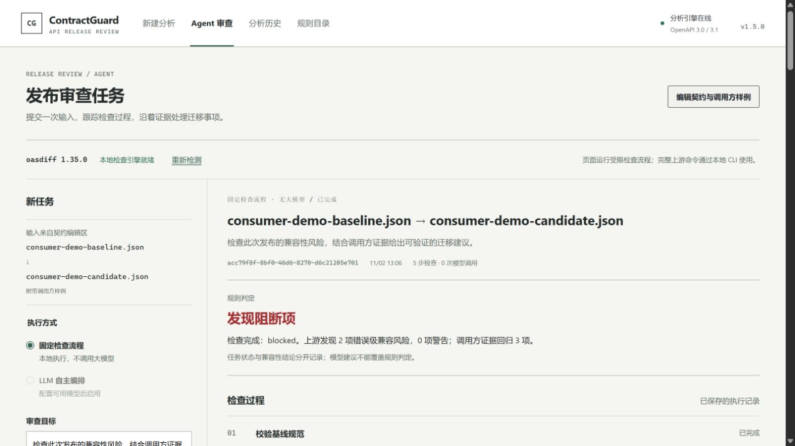

# 验证记录 / Verification Record

本记录按实际版本保留验收过程。当前 **2.0 发布验证**见[专项记录](v2.0-verification.md)，包含版本升级、496 项通过的单元/组件测试、实际页面、真实项目回归、Node 22/24 兼容修复与插件安装证据。以下各节中的“未发布”等状态属于当时的历史记录；当前状态以 GitHub Releases 为准。测试通过只证明已执行用例，不代表全部 OpenAPI 语义、真实模型质量或生产部署均已验证。

## V1.8 真实 DeepSeek 补充验收（2026-11-02）

真实 `deepseek-flash` 经官方云端 API 完成完整订单迁移审查。修正工具用途说明后，最终任务 `3faaf853-dbeb-4df3-b0bf-9dd9557d9dd1` 完成七项必要检查、九次规划请求；调用方迁移、项目真实测试、模型引用、共享历史和完整导出等 **8/8** 组验收通过。基线 2 项通过，候选 1 通过/1 失败，补丁副本 2 项通过；与无模型对照的确定性结果一致，原始 blocked 保留。

完整 `pnpm check` 再次退出 0，合计 **481 通过、2 跳过**（API 由 104 增至 105，其余模块数量见下表）。新增一次工具语义提示回归。真实模型两轮过程、验收脚本参数修复、重试次数、页面截图及文字质量限制见[专项记录](v1.8-deepseek-acceptance.md)。模型自由文本仍存在个别不准确表述，引用校验不等于语义正确；确定性执行证据和门禁未受影响。

## V1.8 内置 Agent 与已有项目测试（2026-11-02，Asia/Shanghai）

环境：Windows、Node.js 24.21.0、pnpm 11.19.0、Vitest 3.2.4、固定 oasdiff 1.35.0。项目执行器、MCP 插件和应用交付标识为 1.8.0；调用方模块保持 1.7.0，原生规则引擎保持 1.5.0。完整 `pnpm check` 退出码 **0**。使用和注册配置见 [V1.8 指南](v1.8-project-agent.md)，真实项目方法见[基准记录](v1.8-benchmark.md)。本轮内容尚未推送或发布 GitHub Release。

### 自动化验证

| 检查 | 实际结果 |
| --- | --- |
| Core / oasdiff / Caller / Project | 203 / 13 / 21 / 13 项通过 |
| API / CLI / Web / MCP | 104 / 23 / 77 / 26 项通过 |
| 单元和组件合计 | **480 通过、2 跳过**；两项跳过仍为 Windows 文件符号链接权限相关，目录 junction 拒绝已执行 |
| 既有回归与包装 | V1.2–V1.7 所有集成、20 个顺序案例、8 个复杂场景、51 项 oasdiff 对照与 7 项插件包装测试通过；构建、类型、文档、配置与冒烟通过 |
| V1.8 产品流程 | **10/10**，真实 MCP stdio、HTTP、caller/core/oasdiff、Node 子进程、历史重启与完整导出；仅模型决策使用受控响应 |
| 订单迁移演示 | 原代码基线 2 通过；候选 1 通过、1 失败；补丁副本 2 通过；测试身份一致，原始门禁仍 blocked |
| 公开项目对照 | openapi-fetch 的六种受控条件全部符合预期；独立 Vitest 与 Agent 的阶段计数和退出码一致 |
| Codex 隔离安装 | CLI 0.166.0-alpha.5.1：临时 marketplace 安装、重复注册校验与真实 stdio 握手，发现 **19 个工具**；未改变用户实际配置 |
| Windows 启动自检 | `start-contractguard.bat --check --no-ai --projects fixtures/project-tests/demo-registry.json` 退出 0，识别 1 个登记项目；未启动服务或请求密钥 |

Project 的 13 项验证覆盖真实 Node 三阶段、Vitest 原有测试、快照冻结、密钥环境隔离、空测试/全部跳过、同数量但测试身份变化、配置外文件被执行、超时/取消、路径与链接、测试预期文件保护及补丁指纹。Agent 新增 7 项覆盖真实工具串联、必要步骤约束、共享调用方历史、模型不接收项目原文、非法基线、输入边界与取消后的迟到结果。CLI 新增 3 项、Web 新增 4 项、MCP 新增 2 项。

产品集成最终证据保存在仓库旁 `ContractGuard-v18-verification-release/`（`results.json`、`agent-report.json`、`caller-report.json`）。`ContractGuard-v18-benchmark-run2/` 保存公开项目六份 Agent 报告、六份 oasdiff 报告及来源/计数；这是一个真实上游库的五项既有 GET 测试，不是完整上游套件或历史事故。每条参考/Agent 路径各执行 60 次测试，其中 **56 次通过、4 次预期失败**，无跳过。全量运行日志为 `ContractGuard-v18-check.log`。

### computer-use 页面验收与修正

在独立 `http://127.0.0.1:18082/` 服务及仓库旁专用历史目录完成验收；AI 关闭，没有读取或改动用户原 8080 服务的密钥。通过网页选择“已登记项目与测试 → 订单字段迁移与已有测试 → 开始审查”，修正后任务 ID 为 `5404f685-c8c0-4045-b7f3-c2ad3cd298cd`，关联调用方记录为 `f2e4fee3-c3f9-4f99-bb07-a8ad3b68db7f`。

- 七个必要步骤全部完成，三阶段计数、补丁 verified 与原始 blocked 同时可见；展开候选执行记录可读到 `toUpperCase` 失败位置。
- 从 Agent 实际点击“查看源码位置与补丁”，打开同一条调用方历史，能查看精确字段位置和候选补丁。
- 下载的完整 JSON 与服务保存记录逐字段一致；刷新页面后从历史重新打开，三个阶段恢复。
- 1280×900 桌面与 390×844 窄屏检查通过；文档实际宽度/滚动宽度分别相等（1265/1265、375/375），无整页横向溢出。检查后恢复默认视口。会话未捕获 console error。
- 修正了 Node 单一文件 reporter 不展示失败详情的问题，加入有界 spec 输出；修正无独立 consumerEvidence 时误写“调用方证据未能完成验证”的总结；更新空状态说明以涵盖项目和迁移包入口。
- 新增组件静态设计检测无发现；独立界面审查实际查看桌面、窄屏及局部截图，结论为 ship，无材料性修正项，沿用既有设计。

截图：[项目测试桌面](assets/v1.8-project-desktop.png)、[窄屏执行记录](assets/v1.8-project-mobile.png)。

### 插件交付与验证边界

可移动归档 `ContractGuard-Agent-Plugin-1.8.0.zip` 位于仓库旁，含 9 个白名单文件；两个 manifest 均为 1.8.0，每项归档内容与准备目录哈希一致，排除密钥、历史、依赖和本机配置。SHA-256：`E0B5DF22CDD8A7F56A2DD8094675E251E2DE896B5FF2C109FF41BA651614FD5E`。插件仍需连接运行中的 V1.8 API 服务。

这轮确实执行了选定的可信 Node/Vitest 测试；普通子进程并非 OS 安全沙箱，不能接收不可信仓库。项目需要一次注册和响应 fixture/transport 适配，字段改名仍需显式映射。公开项目的复杂 SDK 封装保持 AST 未覆盖，未产生自动补丁；不能据此宣称全自动接入任意项目或领先竞品准确率。初轮 LLM 编排使用模拟模型配合真实工具；随后已完成上方记录的真实 DeepSeek 补充验收。没有新增 Antigravity/Harness 宿主模型、Docker 镜像构建、其他系统或远程 CI 验收。

## V1.7 调用方迁移验证（2026-11-02，Asia/Shanghai）

环境：Windows、Node.js 24.21.0、pnpm 11.19.0。调用方模块和插件为 1.7.0，原生规则引擎保持 1.5.0，固定 oasdiff 为 1.35.0。完整 `pnpm check` 退出码 0。源码、接口与输入说明见 [V1.7 使用指南](v1.7-caller-migration.md)。

### 全量与新增验证

| 检查 | 实际结果 |
| --- | --- |
| 构建、类型检查、文档和示例配置 | 通过 |
| Core / oasdiff / Caller | 203 / 13 / 21 项通过 |
| API / CLI / Web / MCP | 97 / 20 / 73 / 24 项通过 |
| 单元和组件合计 | **451 通过、2 跳过**；两项跳过均为 Windows 文件符号链接权限相关测试，目录 junction 越界拒绝已实际测试 |
| 插件包装与搬迁 | 7/7 通过 |
| V1.7 真实集成 | **15/15 通过**：真实 MCP stdio、临时 HTTP 服务、Caller/Core 引擎、磁盘历史与双进程重启 |
| 已有回归 | 冒烟、V1.2、V1.3 多文件/方言、20 个顺序案例、8 个复杂场景、V1.4 七场景全部通过 |
| oasdiff 和既有 Agent/MCP | 51 项 CLI 输出/退出码对照、V1.5 七场景及九项控制、V1.6 十三项集成全部通过 |
| Codex 隔离安装 | CLI 0.166.0-alpha.5.1：临时配置中注册 marketplace、安装插件、验证启动命令及重复注册，再通过真实 stdio 握手发现 18 个工具 |
| Windows 启动自检 | 新增 Caller 产物过期检查后，`start-contractguard.bat --check --no-ai` 退出码 0；未启动服务或读取密钥 |

V1.7 集成的七个业务输入均预先定义期望：无变化对照、改名但未提供映射、显式改名且补丁通过、非法基线、动态 URL、不支持的 `eval`、不存在的改名目标。其余检查覆盖源码指纹与精确修改位置、分页与无损分块导出、非法输入不落成功记录、两类历史隔离、API/MCP 重启恢复和原始文件未被修改。

独立反例审查发现并修正了十种可能误报为安全的输入：六种词法绑定/遮蔽问题（自定义 `fetch`、自定义 `String`、变量初始化前访问、块内暂时性死区、遮蔽 `undefined`、重复声明），一个未识别 SDK 文件被其他通过场景掩盖的问题，以及三种尚未支持的 `fetch` 选项（body、redirect、headers）。修复后十例均保留 `review` / `inconclusive`，没有冒充兼容通过。相应回归已经进入 Caller 的 21 项测试。

完整日志在仓库旁 `ContractGuard-v17-check.log`。最终单独运行 `node scripts/regression-v17.mjs --output ../ContractGuard-v17-verification-final`，再次通过全部 15 项，并保存 `results.json`、`caller-report.json` 和 `caller-report.md`，作为可检查的合成证据。

### computer-use 实际页面验收

使用隔离的本地预览服务 `http://127.0.0.1:18081/` 和独立历史目录，关闭 AI；未改动用户原来 8080 服务的密钥和进程。通过浏览器实际点击“调用方迁移 → 载入迁移示例 → 运行调用方审查”，生成记录 `2ab1e311-415e-4255-8532-5b91ab67ec4d`。

- 页面显示两个 TypeScript 文件、三个调用点；订单名称和联系邮箱共两项回归，订单编号对照通过。
- 两份补丁均显示“已在副本验证”；展开订单补丁后，可以看到 `customerName → displayName` 及 `ALICE`、`ORD-101` 两项复验输出。原始门禁仍为 `blocked`。
- 调用点与字段访问分别显示文件名、行列；关联契约规则、有限重放结果和未覆盖范围均能查看。
- 重新加载页面后，从历史打开相同 ID，完整结果恢复。
- 实际点击 JSON 和 Markdown 下载。下载文件分别与 HTTP 保存记录逐字段相等、与服务导出文本逐字符相等。
- 新建审查后输入非法 JSON，页面显示解析错误；独立核对历史仍只有原来一条成功记录。
- 检查 1280×900 桌面和 390×844 窄屏；窄屏文档 `clientWidth` 与 `scrollWidth` 均为 375（余下为滚动条），无整页横向溢出。长补丁在代码区域内滚动。随后恢复浏览器默认尺寸。
- 此次页面会话未捕获到 console error。

截图：[桌面结果](assets/v1.7-caller-desktop.png)、[窄屏补丁](assets/v1.7-caller-mobile.png)。截图使用合成订单与邮箱，不包含真实业务资料。

### 插件交付与验证边界

`pnpm plugin:prepare` 生成可移动插件；`ContractGuard-Agent-Plugin-1.7.0.zip` 位于仓库旁，包含 9 个白名单文件，两个 manifest 版本均为 1.7.0。逐项校验归档与准备目录哈希相同，包含 MCP 运行包、技能说明与许可证，排除 data、依赖目录和本机配置。SHA-256：`39BE0A4A5F42302CA63D3C9C81B92DEC3BE08681566728D53D6D0F0FEE79F3A5`。隔离安装未更改用户实际客户端配置，也未调用宿主模型。

**这轮证明的是有限 TypeScript AST 解释重放与显式字段改名候选的验证流程。** 未执行调用方项目的 Node.js 程序、安装脚本、完整测试或真实 HTTP；`verified` 只覆盖提交的场景。未新增一次真实 DeepSeek、Antigravity 或 Harness 模型验收，之前的真实模型记录仍归属于对应旧版本。Docker 构建清单已补入 Caller 包，但本轮未构建镜像，也未运行其他操作系统或远程 CI。尚未推送或创建 GitHub Release。

## V1.6 插件验证（2026-11-02，Asia/Shanghai）

### 补充：Antigravity / Gemini 3.8 Flash 十例

按用户指定，在 Antigravity App 2.28.2 的模型选择器中选择 Gemini 3.8 Flash（Medium），使用与 Codex 相同的十组契约对象和预先定义的期望。同一会话按 01–03、04–06、07–10 三批运行；computer-use 实际观察到 12、12、16 张工具执行卡，共 40 次调用，顺序均为状态 → 创建分析 → 读取明细 → 查询历史。三批正常完成，没有观察到模型/业务工具错误或重试。

独立只读脚本执行 11 次 GET（历史 1 次、详情 10 次），确认 10 个唯一分析 ID、每例恰有一条记录，20 个基线/候选源指纹与原 fixture 对象相同。兼容性、规则、严重程度、计数、分数、coverage 及历史/详情全部符合预期，也与 Codex 十例实际结果逐项一致：6 项明确破坏、1 项潜在风险、3 项兼容。

模型选择和实际工具调用依据原生 UI 截图及可访问性记录，保存数据依据 GET 核验；两者分开留档。UI 文本提取有 20,000 字符上限，仅部分参数/返回能完整解析，不声称全部 40 个返回都经过逐字段 UI 核对。所有十例输入内容则通过已保存的源指纹独立校验。没有调用 ContractGuard 内部 DeepSeek，也没有修改服务实现或 MCP 配置。详细结果、分析 ID 和证据目录见 [Gemini 3.8 Flash 验收记录](v1.6-antigravity-gemini38-ten-cases.md)。

### 补充：Codex 十个规范变更场景

本机 Codex CLI `0.166.0-alpha.5.1` 通过已安装插件实际完成十个场景，逐例执行状态检查、创建分析、查询明细及查询历史，共 40 次成功 MCP 调用。结果与预先定义的规则、严重程度、兼容性和计数全部一致：6 项 breaking、1 项 potentially-breaking、3 项 non-breaking。输入未被模型改写，MCP 明细与持久化记录相同，十条分析均能在历史中找到且没有重复创建。

本次共 13 个 Codex 会话：两轮配置预检失败，启用官方命名空间直调配置后 01–07 成功，08 首次工具不可用；确认零工具调用及无新建记录后补测 08–10 成功。三次失败记录均保留，不描述为首次十轮无故障。临时配置保持 `code_mode_host` 开启，设置 `features.code_mode.direct_only_tool_namespaces`，未改全局配置或服务实现。没有调用内部 DeepSeek。逐例业务说明、完整分析 ID、复现命令与证据位置见[Codex 十案例验收](v1.6-codex-ten-cases.md)。

以下保留此前 V1.6 全量回归与三宿主首轮验收记录。

### 全量回归

Windows、Node.js 24.21.0、pnpm 11.19.0；插件 1.6.0，未改动的原生引擎仍为 1.5.0、oasdiff 为 1.35.0。完整 `pnpm check` 退出码 0；原有 API、网页与 CLI 业务实现未因插件接入而替换。

| 检查 | 实际结果 |
| --- | --- |
| 全量构建、类型检查、配置与文档链接 | 通过 |
| 原有 Core / oasdiff / API / CLI / Web | 203 / 13 / 90 / 8 / 68 项通过；CLI 的 Windows 符号链接测试 1 项跳过 |
| MCP 协议与边界测试 | 21/21 通过，包含严格参数、禁止跳转、取消、响应上限和 Unicode 分块 |
| 包装与搬迁测试 | 7/7 通过，复制到中文及空格路径后移除原输出，仍能独立启动和握手 |
| 新 MCP 集成回归 | 13 组通过：真实 stdio → 临时 HTTP 服务 → 实际 core/oasdiff；云模型响应采用受控模拟 |
| 原有完整 CLI 委托 | 51/51 输出与退出码对照通过 |
| 原有 Agent 集成 | 7 个真实引擎场景 + 9 项控制检查通过 |
| 既有业务回归 | 冒烟、V1.2、V1.3 多文件/方言、20 个顺序案例、8 个复杂场景、V1.4 全部通过 |
| Codex 隔离安装 | 本机 CLI 0.166.0-alpha.5.1：全新临时配置中安装 marketplace/plugin，按宿主解析后的命令启动并发现 14 个工具 |

工作区单元/组件测试合计 **403 通过、1 跳过**，另有 7 项包装测试和上述集成套件。模拟 503 与禁用模型会产生预期服务日志，但对应错误分支断言通过。完整日志位于仓库旁 `ContractGuard-v16-check.log`。CI 未重新运行，Docker 镜像与其他操作系统尚未实机验收。

新增集成验证了：双向共享普通分析历史、多文件与调用方结果一致、三种报告无损重组、AI 保存/缓存/显式再生成、模型失败不落成功记录、MCP 取消传到模拟模型 AbortSignal、后台任务显式取消、API/MCP 双重重启恢复、停用模型后仍可读取旧解读。测试使用临时目录和端口，不混入用户的历史。

### 真实 DeepSeek 与网页互通

另外通过生成的 portable bundle 向已运行的本机服务发起真实模型请求，只使用仓库零售合成材料。普通分析 `d944e4be-1dcc-4ffa-86d9-ac8c308eb1af` 成功保存，真实 AI 解读 `70063138-200c-4bff-8356-7c3791c43b03` 可查询和导出。

LLM 审查 `6cc6c424-b128-4e45-b476-e97fe22d31e5` 于 13:29 完成：`deepseek-cloud / deepseek-flash`，5 项必要工具、6 次规划模型调用、3 条迁移建议，确定性结论 `blocked`、上游 breaking 2 项、调用方回归 3 项。所有建议证据 ID 属于实际结果集合，MCP 分块导出的完整 JSON 与 HTTP 记录逐字段相同。AI 解读是另一次模型请求，不包含在 6 次规划调用中。

computer-use 在 Edge 打开相同服务，确认普通历史中出现该分析、已保存 AI 解读自动恢复，Agent 历史可打开相同审查 ID，页面显示“5 步检查 · 6 次模型调用”及阻断结论。原内置浏览器连接当时不可用，使用已打开的 Edge 完成验收。实际报告、概要记录与截图保存在仓库旁 `ContractGuard-v16-verification/live-model/`，没有保存密钥。

这证明本次合成场景的插件/服务/模型互通，不证明模型每次生成的文字均正确。结构和证据引用可校验，建议内容仍需结合确定性检查复核。

### 三款真实 Agent 宿主验收

在用户授权下，将插件接入本机已安装的三款宿主，保留各自已有配置。以下是实际宿主模型执行结果，区别于前述独立 SDK 握手测试。输入仅包含合成的单接口契约；删除接口应产生一项 `PATH_REMOVED`，`compatible=false`。所有成功创建的记录都另经 ContractGuard HTTP 历史核对。

| 宿主与版本 | 实际执行 | 结果与限制 |
| --- | --- | --- |
| Codex CLI 0.166.0-alpha.5.1 | 已安装并启用本地插件；真实模型完成 status → analyze → get_analysis → list_analyses，共 4 次调用 | 有完整成功记录；重复会话中也出现工具发现成功、调用时 `tools.… is not a function` 的宿主分派错误。不能判定为稳定通过 |
| Antigravity 2.28.2 | computer-use 在桌面会话执行 status、analyze、get_analysis overview/changes、list_analyses，共 5 次调用 | 通过；界面显示 Gemini 4 Argon Medium。正常退出并重开应用后才加载新增 MCP 配置 |
| DeepSeek Harness 0.2.1-rc.5 | computer-use 在已登录桌面会话执行相同 5 次调用，并查看 Trajectory 工具轨迹 | 通过；界面显示 DeepSeek-V4.1-Flash。另行尝试的无界面 CLI 因独立配置未登录返回 `ACCOUNT_SIGN_IN_REQUIRED`，未计为通过 |

成功分析 ID：Codex `86ecfb70-53f8-444a-9ff9-87fdb5c36a12`，Antigravity `22a22d6f-bc89-4810-b1df-ee38f8db249c`，Harness `2a8bf573-ba0e-4065-8f0e-e760f14ce92c`。后两者为移除 `/ping` 的用例，均得 88 分、一项破坏性变更，宿主查询的历史 ID 与新建记录相同。

三宿主测试使用宿主自身的模型，不重复调用 ContractGuard 内部 AI 解读或 LLM 审查；后者的真实 DeepSeek 验收见上一节。没有读取或迁移账号凭据，也没有将 API Key 加入插件配置。Codex 使用 CLI 验收，未操作 Codex 桌面界面。各宿主结果和桌面截图保存在仓库旁 `ContractGuard-v16-verification/` 下对应的 `codex-host`、`antigravity-host`、`deepseek-harness-host` 目录。配置文件备份仅留在原本机配置目录，不进入交付包。

## V1.5 本地验证（2026-11-02，Asia/Shanghai）

### 补充：真实 DeepSeek 验收

在用户通过本机 PowerShell 隐藏提示输入密钥后，使用 `deepseek-cloud` / `deepseek-flash` 向官方云端发起真实请求。首次任务 `7f1aaaf8-254b-4fa6-b9c8-b75116846fa3` 在三步工具检查后因模型决策不合法而失败，记录保留，没有记为通过。

据此修复：每步 schema 动态约束当前允许工具，明确非结束步骤的空摘要/空建议格式；无效结构或证据最多请求纠错一次，不执行被拒动作。纠错仍共用该决策的时间预算，计入模型请求数；鉴权失败、超限、取消不重试。增加三项回归，API 全套 90 项通过（含 Agent 35 项），真实引擎的 7 场景 + 9 项集成控制检查通过。

重新构建并由用户重启后，真实任务 **e3d7e924-eeeb-43f6-b416-dc6269b87515** 正常完成：LLM 模式、5 项必要工具检查、6 次真实模型请求、4 条迁移建议。上游 2 项错误级变更、调用方 3 项回归，确定性结论 blocked 符合预期；所有建议引用都属于实际证据集合。本次成功运行没有触发纠错重试。使用的都是仓库合成零售材料，没有探测真实业务服务。

computer-use 在工作台打开了已完成的 LLM 任务，核实“5 步检查 / 6 次模型调用”、中文摘要、blocked 结论和启用的自主编排选项。Markdown 导出通过实际 HTTP 获取并保存。记录和截图位于仓库旁 `ContractGuard-live-deepseek-results/`；配置文件 `config/llm-providers.local.json` 已被 Git 忽略且不包含密钥。密钥由启动器放入本次进程环境，不写入项目文件或永久系统环境变量。

以下是此前的初始 V1.5 验收记录；其中“真实云模型未运行”描述的是补充验收之前的状态。

环境：Windows、Node.js 24.21.0、pnpm 11.19.0、ContractGuard 1.5.0、官方 oasdiff 1.35.0。完整 `pnpm check` 退出码 0。随后调整根级 test/typecheck 前置构建依赖、启动日志显示与使用文档，重新构建并验证前置构建、Windows BAT 自检；最终 V1.5 集成套件再次通过并保存产物。没有推送或触发远程 CI。

| 检查 | 结果 |
| --- | --- |
| 生产构建与全部 TypeScript 检查 | 通过 |
| Core | 203/203 |
| oasdiff 安全执行包 | 13/13，真实固定引擎执行，0 跳过 |
| API / AI / Agent | 87/87（44 + 6 + 5 + 32） |
| CLI 格式与文件加载 | 8 通过，Windows 符号链接权限测试 1 跳过 |
| Web | 13 数据工具 + 55 组件交互用例通过 |
| 单元与组件合计 | **379 通过，1 跳过** |
| 官方 CLI 透传对照 | **51/51**，stdout、stderr、退出码一致 |
| Agent 真实引擎集成 | **7 场景 + 9 个生命周期 / CLI / 模型接口控制检查**通过 |
| 既有场景 | 冒烟 2 例、V1.2 八例、V1.3 多文件与方言、20 原子场景、8 复杂场景、V1.4 七场景全部通过 |
| 文档链接与示例配置 | 通过 |

CLI 对照覆盖主命令和子命令帮助、778 / 121 检查目录、覆盖目录、输出 schema、shell completion、九种 breaking 格式、严重等级配置、筛选和语言、前缀、stdin、本地引用、glob 组合、回环 URL 输入、隔离临时 Git 仓库中的 revision / breaking-files / diff-driver，以及错误退出码。这是委托行为验证，不是重新证明上游全部规则正确，也不是覆盖率排行榜。

七个真实 Agent 场景：零售破坏变更、契约相同但调用方回归、正向对照、缺少候选样例、未提供调用方证据、3.2 原生分析缺口、无效契约。九项控制检查覆盖取消、未知字段拒绝、远程引用拒绝、未启用模型、重启恢复、CLI pass / review / 输入覆盖保护、真实工具与模拟模型回复的完整编排。最后一项使用真正的模型请求适配器和 oasdiff，通过模拟响应选择不同合法顺序，6 次决策后正常结束；没有向 DeepSeek 发起真实云调用。

独立复核发现并修复：最终状态先于磁盘保存、上游诊断夹带私有 enum 字面值、相同风险因工具顺序重复计数、较大标题导致终态无法保存。对应的慢写、写失败、真实引擎私有值、逆序调用和超限输入回归均已通过。模型不得跳过必需工具、重复工具或引用虚构证据；取消后的迟到回复不能覆盖终态。

### 实际页面验收

在隔离本机服务和生产构建上，使用 computer-use 点击“载入调用方示例”“运行兼容性分析”：页面显示 76 分、2 项原生破坏、3 调用方 / 4 检查 / 3 回归。再点击“交给 Agent 审查”“开始审查”：界面显示真实 oasdiff 1.35.0、固定流程、5 步完成、0 次模型调用、2 项上游错误、3 项调用方回归、证据编号和迁移事项。未配置模型时自主编排选项正确禁用。实际截图如下：

最初截图后浏览器操作中断；恢复控制后，使用最终构建重开隔离服务，完成一次同样的真实任务，并覆盖本节截图。刷新页面、打开 Agent 页后，原任务 `acc79f8f-8bf0-46d6-8270-d6c21205e701` 自动恢复，保留 5 步和 blocked 结论。设置 390×844 的窄屏视口后，实际内容区宽 375（扣除滚动条），document scrollWidth 同为 375，没有横向溢出；导航、任务表单及结果文字均可读。保存了[窄屏顶部](assets/v1.5-agent-mobile.png)与[窄屏结果](assets/v1.5-agent-mobile-result.png)，随后恢复默认视口。

通过页面“导出 Markdown”实际下载任务报告，并读取文件核对任务 ID 与 blocked 结论；副本见[实际任务示例报告](../examples/reports/agent-retail.md)。组件测试另覆盖取消、轮询失败恢复、切换任务的迟到回复和卸载中止；HTTP / CLI 保存与重启已在集成套件验证。Docker 镜像、Linux/macOS 实机和真实云模型未运行验收。

完整日志位于仓库旁 `ContractGuard-v1.5-check.log`；独立对照记录 `ContractGuard-v1.5-oasdiff-parity.json`；真实任务报告位于 `ContractGuard-v1.5-agent-regression/`。均为本项目合成测试材料。复现命令：`pnpm engine:install`，再运行 `pnpm check`；可给新脚本传 `--output` 保存产物。

## V1.4 本地验证（2026-11-02，Asia/Shanghai）

环境：Windows、Node.js 24.21.0、pnpm 11.19.0、ContractGuard 1.4.0。完整 `pnpm.cmd check` 已通过。之后将回归包输出改为紧凑 JSON，避免导出缩进把临界大小的包扩大到重跑读取上限之外；针对这项修改另行重建 CLI 并重跑完整 V1.4 跨入口套件。此处记录本地工作区结果，不表示远程 CI 已运行、已推送或发布。

| 检查 | 结果 |
| --- | --- |
| 生产构建、各包类型检查 | 通过 |
| Core | 203/203；原 135 项 + 调用方 42 项 + 样例 Schema 20 项 + 回归包 6 项 |
| API / AI | 55/55；44 项既有 + V1.3 六项 + V1.4 五项 |
| CLI 格式 / 加载器 | 5 + 3 项通过，原 Windows 符号链接权限测试 1 项跳过 |
| Web 数据工具 / Vue 组件 | 13 + 45 项通过，包含 16 项新增调用方与历史展示组件回归 |
| 上述合计 | **324 项通过、1 项跳过**；跳过不计为通过 |
| 既有跨入口与场景套件 | 冒烟 2 例、V1.2 八例、V1.3 多文件回归、原子 20 例、复杂 8 例均通过 |
| V1.4 Core / 实际 HTTP / CLI / 回归包 | 7/7 场景；独立门禁、导出和重启恢复通过 |
| 官方工具能力范围对照 | 4/4 固定案例符合预期；oasdiff 1.35.0、OpenAPI-diff 2.1.7 |
| 文档链接与示例配置 | 通过 |

### V1.4 七个跨入口场景

运行 `node scripts/regression-v14.mjs --output ../ContractGuard-v1.4-regression-results`。预先确定每例状态与计数，再核对完整语义结果，包括规范来源、策略、静态 finding、调用方问题和迁移任务。Core、HTTP 和 CLI 使用相同的规范文本字节；对象输入使用规范化 JSON 指纹，不能与文本输入的字节指纹混作相同表示。

| 场景 | 通过 / 回归 / 基线无效 / 证据不足 | 调用方门禁 |
| --- | --- | --- |
| 多调用方零售升级 | 1 / 3 / 0 / 0 | blocked |
| 契约未变、响应不满足调用方约束 | 3 / 1 / 0 / 0 | blocked；静态 100 分、0 变化 |
| 正常对照 | 4 / 0 / 0 / 0 | pass |
| 缺少候选响应样例 | 3 / 0 / 0 / 1 | review |
| 原基线样例已经无效 | 3 / 0 / 1 / 0 | review |
| 不支持的 pattern 约束 | 3 / 0 / 0 / 1 | review |
| 删除没有调用方样例映射的操作 | 4 / 0 / 0 / 0 | review；静态门禁仍独立触发 |

套件分别执行 consumer regression/review/never 门禁，验证 `--fail-on never` 不会关闭调用方门禁，以及关闭调用方门禁不会取消静态破坏。每例都创建回归包、验证同引擎重跑一致、拒绝重复写包和内容篡改、拒绝通过硬链接或 Windows 大小写别名把报告写回包文件。显式声明调用方门禁但未提供清单时拒绝运行。隔离 HTTP 服务重启后，七份结果均恢复一致。

报告导出包含调用方门禁与迁移信息。API 用独有样例标记验证响应、持久化文件、Markdown/HTML/JSON 导出不泄露原始样例值；这不代表标识符、负责人、字段名和静态 finding 已自动匿名化。显式回归包按设计保留原输入。

原始测试记录位于仓库旁 `ContractGuard-v1.4-regression-results/`；完整检查日志为 `ContractGuard-v1.4-check.log`。目录中的回归包只有本项目合成数据，不包含真实生产交互。

### 复核发现与修复

独立复核及集成测试发现并修复：媒体类型大小写重复造成错误的“不存在”结论、回归包校验后规范化导致指纹失配、显式默认调用方门禁在无清单时被跳过、Windows 路径别名覆盖回归包、历史列表静态 100 分掩盖调用方回归、模型低风险意见遗漏调用方 blocked 提醒。

相应断言验证了修复；没有调整业务预期来迁就错误输出。测试脚本自身曾把对象指纹和文本指纹直接比较，也曾漏掉 Markdown 对连字符的转义，已统一输入表示和正确解读导出表示。

### 实际页面交互

在隔离的本地生产构建上，使用 browser computer-use 打开页面，点击“载入调用方示例”和“运行兼容性分析”。真实页面可访问性树确认：引擎 1.4.0、静态 76 分 / 两项破坏、三调用方四项检查 / 三回归一通过、quantity 与 receiptUrl 的失败路径、负责人、三项迁移任务，以及分析进入历史计数。未调用云端模型。

随后截图请求在分发前被中止，没有取得新截图。因此本轮完成的是页面操作与结果核对，**未完成视觉截图、窄屏和新历史列的实际页面验收**；历史列的 blocked/review/pass/旧报告与损坏数据由组件测试覆盖。验收服务和隔离临时历史已清理，不影响用户已有记录。

### 对照试验的解释边界

[官方工具范围对照](v1.4-engine-comparison.md)保留四份场景预期、工具版本、指纹、命令、原始输出与退出码。普通请求约束收紧三者均能发现；规范未变的案例三者静态结果均无变化，ContractGuard 的调用方判断依赖另外提供的样例和断言。这是新增输入与工作流的价值，不是其他 diff 引擎漏报，也不能得出 ContractGuard 的规则准确率、覆盖或成熟度全面领先。

本轮没有调用真实 DeepSeek 等云端服务；AI 使用受控模拟响应。没有新增线上业务系统验证、真实 API 历史语料准确率、性能压测、Docker 或远程 CI 结果。详见 [V1.4 使用与边界](v1.4-consumer-impact.md)。

## V1.3 本地自动化验证（2026-10-27，Asia/Shanghai）

环境：Windows 11、Node.js 24.21.0、pnpm 11.19.0、TypeScript 5.9.3、ContractGuard 1.3.0。完整 `pnpm check` 已通过，包含构建、类型检查、各包测试与跨入口回归。以下是本地结果，不表示已发布或已推送，也不作为新版远程 CI 已通过的依据。

| 检查 | 本轮结果 |
| --- | --- |
| 标准构建、各包类型检查 | 通过，包括 Vite 生产构建和组件测试类型检查 |
| Core 单元、规则与多文件回归 | 135/135 通过 |
| API / AI 既有回归与 V1.3 集成回归 | 44 + 6，共 50 项通过 |
| CLI 格式与转义 | 5/5 通过 |
| CLI 本地文件包加载器 | 3 项通过、1 项跳过；当前 Windows 环境无创建测试符号链接的权限 |
| 前端数据与文件导入工具 | 13/13 通过 |
| 真实 Vue 组件交互（Vitest + jsdom） | 29/29 通过 |
| 以上测试合计 | 235 项通过、1 项跳过；跳过项不计为通过 |
| 原集成 manifest 冒烟 | 2/2 通过 |
| V1.2 Core / API / CLI 跨入口语义一致性 | 8/8 原子案例通过 |
| V1.3 多文件与覆盖范围跨入口回归 | `scripts/v13-regression.mjs` 通过 |
| V1.3 新增顺序验收集 | 20/20 符合预先标注的期望；16 个有效契约、4 个明确拒绝的输入 |
| V1.3 复杂业务场景 | 8/8 通过；57 条精确 finding 与独立标签一致，8 份分析重启后恢复 |
| 文档本地链接、配置和示例检查 | 通过 |
| Windows 启动器 `--check --no-ai --no-pause` | 通过；未启动服务、未询问凭据 |

多文件测试覆盖显式 YAML/JSON 文件包、相对引用与 JSON Pointer、循环引用的有界处理、缺文件与缺片段错误、路径边界、文件数量和大小预算，以及示例数据中的 `$ref` 不被误当成依赖。指纹按实际入口与传递依赖计算，并核验清单顺序不影响结果、变更能够定位到原文件和指针。符号链接跳过项需在具备相应权限的环境重跑，不能据此声称该平台路径场景已全部实测。

方言与覆盖范围回归涵盖受支持的 OpenAPI 3.0/3.1 等价写法、未覆盖结构的独立提示，以及无 breaking 但 `coverage` 为 `partial` 时的门禁行为。`complete` 只表示本轮受支持规则未发现已知覆盖缺口，不是形式化兼容性证明；未记录覆盖范围的旧报告也不推断为完整。

V1.3 跨入口脚本用同一组 `fixtures/multifile/` 文件核对 Core 显式文件包、HTTP 显式文件包与 CLI `--bundle` 的语义结果，并排除报告 ID 和时间等非语义字段。脚本同时核验原文件来源、清单顺序稳定指纹，以及 3.0→3.1 的可空等价案例。对于没有 breaking 的 partial 案例，默认 CLI 退出 0；显式 `--fail-on never --fail-on-incomplete` 退出 2，且不生成虚假的 breaking finding。

API 和 AI 自动化沿用受控模拟响应；没有调用真实云端模型，没有读取用户模型 key。本轮没有新增 Docker daemon 构建、远程 CI、真实 LLM 连通性或自然语言质量验证，也没有建立真实数据集准确率或性能基准。运行方式与支持边界见 [V1.3 指南](./v1.3-upgrade.md)。

### V1.3：20 个固定案例的顺序验收

执行命令为 `node scripts/acceptance-v13.mjs --output-dir ../ContractGuard-v1.3-20-case-results`。20 个案例按编号依次执行，每例先校验独立标注的期望，再核对 Core、实际 HTTP API 与 CLI 的 findings、等级、证据、coverage、来源、指纹和门禁。比较只排除 ID/时间等非语义字段，以及 JSON 传输本来就不保留的可选 `undefined` 属性；定义了值的字段完整保留。

结果为 **20/20 通过，0 失败**。16 个有效案例另行验证 API 历史读回、Markdown/HTML 导出和独立的 `--fail-on-incomplete`；其余 4 个案例预期失败，正确返回约定错误、CLI 退出 1，且没有创建成功历史。重启隔离 API 后，16 份历史的完整语义结果一致。

输入和独立期望保存在 `fixtures/v1.3-acceptance/`；场景表、单例运行和复现命令见 [20 案例说明](./v1.3-acceptance-cases.md)。本次生成的 `results.json`、逐例 Core/API/CLI 证据及有效案例导出报告保存在源码仓库外的 `ContractGuard-v1.3-20-case-results/`，不混入用户历史。套件已加入 `pnpm check`，也可单独执行 `pnpm acceptance:v13`。这是 20 个合成场景的功能验收，不是 20 次浏览器验收，不建立真实数据 precision/recall 或性能结论。

首轮扩展套件发现的是测试脚本自身的两个表示口径问题：API 导出使用 `Status:` 文案；HTTP JSON 会省略值为 `undefined` 的可选属性。修正脚本的断言与 JSON 比较后重新执行全部 20 例，没有改变产品规则或预先标注的兼容性期望来迎合输出。

### V1.3：8 个复杂业务场景

本轮重新生成业务复合输入，保留原 20 个原子／边界案例。执行 `node scripts/scenarios-v13.mjs --output-dir ../ContractGuard-v1.3-complex-results`，结果 **8/8 通过、0 失败**。每侧契约有 7–12 个实际依赖文件，多个操作共享模型、参数和响应；各组包含同步变更及不应受到影响的控制操作。

| 场景 | 实际依赖 old/new | breaking / potential / non-breaking | coverage | 结果 |
| --- | --- | --- | --- | --- |
| 电商结算与订单追踪 | 10 / 10 | 5 / 2 / 0 | complete | 通过 |
| 商品检索与游标分页 | 9 / 9 | 3 / 2 / 1 | complete | 通过 |
| 批处理提交、轮询与结果交付 | 12 / 12 | 4 / 4 / 1 | complete | 通过 |
| 多租户身份与 SDK 迁移 | 11 / 11 | 6 / 2 / 0 | complete | 通过 |
| multipart 资产上传与异步导入 | 9 / 9 | 7 / 1 / 0 | partial | 通过 |
| 递归设备树与遥测配置 | 12 / 11 | 6 / 2 / 0 | partial | 通过 |
| 等价方言迁移与安全扩展 | 7 / 7 | 0 / 0 / 6 | complete | 通过 |
| 合作伙伴 REST 与 webhook 通知 | 11 / 11 | 3 / 2 / 0 | partial | 通过 |

共核对 57 条 finding（34 breaking、15 potentially-breaking、8 non-breaking）。这里按实际受影响操作计数：同一个共享模型影响两个操作时会产生两处 finding，不把它们当成两个独立的真实项目样本。安全演进中的 nullable、整数边界等价迁移没有误报成变更，6 项兼容扩展没有触发 breaking。未变控制操作均未产生 finding。

三份 manifest 预先记录业务交互见证、固定 `ruleId + severity + location` 集合、控制位置和指定原文件来源。复合场景通过共享的 `scripts/lib/acceptance-suite.mjs` 校验独立摘要／门禁、精确 finding 位置、24 项来源检查、逐文件 SHA-256、输入清单逆序不变，以及 Core／实际 HTTP／CLI 全量语义一致。还检查 Markdown/HTML 导出包含规则、覆盖告警与指定原文件引用；这些是内容断言，不是完整视觉排版测试。8 份有效分析均在隔离 API 重启后恢复，AI 始终关闭，无真实云端调用。

`partial` 的三组按预期通过，表示工具明确保留了 multipart encoding、递归／组合 schema、callback、webhook、servers 等有限支持范围，不表示这些行为已经被证明兼容。资产案例中的 `sizeBytes` 是规范声明的业务数值字段，没有将它或 binary 格式解释成服务器已验证真实文件字节数。旧客户端交互是契约判断见证，没有部署、调用真实支付／设备等业务服务。

抽取共享测试逻辑后，原 20 案例重新运行仍为 20/20，包含新套件的完整 `pnpm check` 也通过；原单元/API/组件统计仍为 235 通过、1 项权限相关跳过。本轮没有发现需要修改产品规则的漏报或误报，没有为通过测试修改预先标签；新增的是复合数据集、测试复用和更严格的断言。

场景设计与复现方法见 [8 个复杂业务场景](./v1.3-complex-scenarios.md)。本次逐例 JSON、Markdown、HTML 与汇总证据保存在仓库外的 `ContractGuard-v1.3-complex-results/`，完整检查日志为 `ContractGuard-v1.3-complex-check.log`。这是合成功能回归，不是新增浏览器验收、真实准确率或性能基准。

### V1.3 computer-use 页面实测

前两次 computer-use 尝试因无法可靠确认 Windows 浏览器的当前 URL，被自动安全检查中止；不计为通过。用户手动打开本地页面后，完成以下真实 Edge 页面操作与观察。服务绑定回环地址并使用独立临时历史，AI 明确关闭，没有读取真实 key 或调用云端模型。

| 实测路径 | 观察结果 |
| --- | --- |
| 载入多文件示例并运行分析 | 2 个 findings：1 breaking、1 potentially-breaking，评分 84，历史增加 1 条 |
| 展开覆盖范围 | 显示候选 `WEBHOOKS_NOT_ANALYSED`，来源 `openapi.yaml#/webhooks`，与分数独立展示 |
| 展开来源与策略 | 显示引擎 1.3.0、两侧方言、入口、各 2 个实际依赖及逐文件 SHA-256 |
| 展开类型变更 | 两侧原文件均为 `schemas/order.yaml#/properties/id/type`，无双 `##`；证据为 string→integer |
| 原生选择器导入两侧 `fixtures/multifile/` 目录 | 各载入 2 文件，预览与实际 Local Orders 规范一致；保留子目录引用 |
| 替换输入后查看旧报告提醒 | 明确显示输入已变更，原报告不代表当前编辑内容 |
| 核对真实目录的分析结果 | 观察到 1 breaking、0 potential、评分 88、独立 webhook 提示；分析运行期间有用户手动操作，结果由页面复核 |
| 后续从历史重开真实目录报告 | 打开同一报告 `15e63c18-1a72-4489-920a-049fa0c0580d`，进入“历史分析报告”独立只读视图，仍为 88 分且保留未覆盖提示 |
| 从历史下载 JSON、Markdown、HTML | 三种导出均触发页面成功通知；Edge 下载面板显示同一报告 ID 对应的 `.json`、`.md`、`.html`，均可“打开文件” |
| 点击浏览器刷新，再从历史重开 | 页面刷新后，两条历史仍在；重新打开同一份 88 分报告，方言、两侧各 2 个依赖及指纹、`WEBHOOKS_NOT_ANALYSED` 和 `openapi.yaml#/webhooks` 均恢复 |

原生文件选择器的鼠标坐标出现工具偏差，改用键盘导航后完成目录选择，未因此修改产品。随后按 F5 验证刷新时，工具再次因 URL 确认不足自动终止；第三次中止同样没有绕过，也不计为完整验收通过。已保存两张覆盖范围／来源截图供对话交付，未将截图写入源码仓库。

在用户后续授权的测试轮次中，完成历史重开、JSON/Markdown/HTML 实际下载，以及点击浏览器刷新按钮后的历史恢复；新增下载和恢复截图供交付复核。没有再次使用被中止的 F5 快捷键；普通刷新按钮操作通过本轮工具检查后执行，没有绕过安全提示。页面刷新后编辑区恢复为空，历史中的分析仍为独立只读结果，不伪造原始契约文本。

以上列出的实际页面路径均通过，未发现产品功能错误；其中目录分析运行期间有用户操作，已单独标明。20 个顺序场景仍是 Core/API/CLI 自动化，不将其重复计为 20 次浏览器验收。未进行全部浏览器、全部窄屏、独立 HTML 视觉排版或真实云端模型验收；也没有自动打开或执行下载面板中的其他文件。隔离测试服务已正常退出，自有临时数据和脚本已清理，测试端口不再监听；浏览器下载和用户数据保留。原来的待补占位已由真实执行项和明确边界替换。

## V1.2 本地验证（2026-10-27，Asia/Shanghai）

环境：Windows 11、Node.js 24.21.0、pnpm 11.19.0、TypeScript 5.9.3、ContractGuard 1.2.0。锁文件重新安装后，标准 `pnpm check` 成功完成，不需要 portable builder。仓库 CI 仍面向 Node.js 22；本轮没有推送，不声称已经获得新版的远程 CI 结果。

| 检查 | 本轮结果 |
| --- | --- |
| 标准构建、各包类型检查 | 全部通过，包括 Vite 生产构建和组件测试类型检查 |
| Core 单元与原子规则回归 | 71/71 通过，其中 V1.2 新增 31 项 |
| API / AI 集成与持久化回归 | 44/44 通过，其中 V1.2 新增 13 项 |
| CLI 格式与转义 | 3/3 通过 |
| 前端数据归一化 | 10/10 通过 |
| 真实 Vue 组件交互（Vitest + jsdom） | 20/20 通过：工作区 9 项、AI 11 项 |
| 以上测试合计 | 148/148 通过 |
| Core / API / CLI 跨入口语义一致性 | 8/8 原子案例通过，同时核验 CLI 门禁退出码 |
| 原集成 manifest 冒烟 | 2/2 通过，演示结果保持不变 |
| 文档本地链接、配置和示例检查 | 通过 |
| Windows 启动器 `--check --no-ai --no-pause` | 通过；未启动服务、未询问凭据 |

Core 新增用例涵盖 3.0/3.1 上下排他边界、零端点、整数等价区间、组合重叠/重排/引用及有界比较、参数默认序列化、响应头、开放/关闭请求对象。跨入口回归脚本为 `scripts/regression-test.mjs`，不是将同一份输出重复计为独立准确率样本。

API 回归使用 mock provider，核验实际发送 ID 集合、裁剪数量、模型意见与规则分离、重启恢复、配置/输入/策略/引擎变更失效、显式 force、失败不缓存、历史导出、损坏解读隔离、并发合并、订阅者取消、删除与磁盘保存竞争。没有调用真实云端模型，也没有读取用户的模型 key。

组件回归挂载实际 `App.vue` 和 AI 组件，覆盖分析期间编辑/清空/载入示例、迟到结果、历史只读状态、筛选/展开/导出、AI 恢复/关闭仍可读取、Provider/关注点切换、force 和迟到历史请求。不把 jsdom 测试表述为真实浏览器或像素布局测试。

首次尝试通过 Windows 浏览器执行人工验收时，Computer Use 安全检查无法可靠确认当前浏览器 URL，因而中止，没有继续操作。随后用户明确要求再次执行 computer-use 测试；在重新观察并确认本地页面地址后，完成了下述补充桌面实测。首次中止不计为通过，也不据此声称绕过了安全检查。

### 补充 computer-use 桌面实测

使用 Microsoft Edge 的真实页面，所有页面交互均通过 computer-use 进行。服务绑定本机回环地址、使用独立临时数据目录；AI 接入受控本地模拟响应，不读取用户真实 key、不发云端请求。服务日志和保存记录数量作为调用复用的辅助证据，不替代页面验证。

| 实测路径 | 观察结果 |
| --- | --- |
| 载入 Campus Events 演示并运行分析 | 页面生成 11 条结果：7 breaking、3 potential、1 non-breaking，评分 4/100；进入历史 |
| 在候选输入末尾增加测试注释 | 显示“输入已变更”，明确下方报告对应上一次提交，不代表当前内容 |
| 打开历史报告与来源详情 | 独立只读视图，展示引擎 1.2.0、默认策略和输入/策略 SHA-256 |
| 填写关注点并生成 AI 解读 | 保存成功，显示模型、关注点、`ai-explainer-v2`、关联 `CG-0001` 及覆盖 3/11、遗漏 8 条 |
| 点击 AI JSON 下载 | Edge 下载面板显示对应 review UUID 的 JSON 文件，下载完成 |
| F5 刷新后从历史重开 | 恢复同一解读和关注点；模拟调用仍为 1 次、保存解读仍为 1 份 |
| 点击默认“生成或读取” | 复用原报告；调用数和保存份数仍为 1 |
| 点击显式“按当前选项重新生成” | 更新生成时间；累计 2 次模拟调用，保留 2 份解读 |

本次已完成路径未发现阻塞问题。截图作为本次对话的交付文件保存，未写入源码仓库。测试服务已关闭；没有修改用户原有历史或真实模型配置。本次不包括慢请求取消的真实浏览器验证、文件上传、Markdown 下载、390 px 窄屏或全部跨浏览器覆盖，相关自动化测试不能替代这些人工项目。Docker daemon 构建、真实云端自然语言质量、真实数据集 precision/recall 与性能基准仍未验证。

升级、AI 历史与复用说明见 [V1.2 指南](./v1.2-upgrade.md)。single-flight 和删除协调仅适用于单个 API 进程，不承诺多进程共享目录时的分布式去重与删除一致性。

## V1.1 历史验证（2026-09-23）

以下是 1.1.0 的历史记录，不作为 1.2.0 已完成浏览器或 Docker 验收的依据。

### 环境

- Windows 11（受限桌面沙箱）
- Node.js 24.21.0
- pnpm 11.19.0
- TypeScript 5.9.3
- ContractGuard engine 1.1.0

项目最低运行版本为 Node.js 22.13，与 pnpm 11.19 的运行要求一致；CI 使用 Node.js 22 验证主流 LTS 环境。

### 已通过项目

| 检查 | 结果 |
| --- | --- |
| Core TypeScript typecheck/build | 通过 |
| API TypeScript typecheck/build | 通过 |
| CLI TypeScript typecheck/build | 通过 |
| Vue application + Vite config typecheck | 通过 |
| Core unit tests | 40/40 通过 |
| API tests | 31/31 通过 |
| CLI formatter/security tests | 3/3 通过 |
| Frontend data-processing tests | 8/8 通过 |
| End-to-end manifest smoke test | 2/2 case 通过 |
| 静态 Web、API、历史、规则与 HTML 报告链路 | 通过 |
| 桌面端与 390 px 窄屏 Web 布局 | 通过；未发现页面级横向溢出 |
| 导出菜单键盘关闭、焦点恢复与 finding 展开区域 | 通过 |
| AI 默认关闭、缺失配置与状态接口 | 通过 |
| AI 请求裁剪、响应上限、JSON 恢复、结构校验、超时和安全错误降级 | 通过（fake provider） |
| AI 前端状态与结构化响应归一化 | 通过 |
| 多 LLM 配置解析、档案选择、能力参数与旧版 DeepSeek fallback | 通过（fake provider；未调用云端） |
| 规则策略校验、启停/重分类、评分与输入/策略 SHA-256 | 通过 |
| Web → API → AI 适配器 → 结构化展示完整流程 | 通过（本机 mock OpenAI-compatible 端点） |
| Windows BAT/PowerShell 启动器：帮助、配置/策略检查、失败退出码、禁用 AI 与健康检查 | 通过；未调用云端 |
| 文档本地链接 | 18 个 Markdown 文件、118 个本地链接通过 |
| 配置与示例 | 7 个 YAML、5 个 JSON、17 个环境变量通过静态校验 |

冒烟测试会真正启动已编译 API，确认 Web 静态资源可访问，再读取 `fixtures/evaluation-manifest.json`，逐条创建分析并验证 `mustContain`、`forbiddenSeverities` 与兼容性结论，最后检查 HTML 报告包含证据。

AI API 测试通过注入 fake `fetch` 验证档案选择、Provider 专属 token 参数、Bearer key 不进入正文、原始 OpenAPI 不被发送、finding 有界、change ID 必须可追溯、JSON 结构严格校验、列表安全裁剪、带少量外围说明的完整 JSON 恢复、响应大小上限、响应体挂起时仍能超时、HTTP 客户端断开可取消上游请求，以及上游错误不会泄露 key 或响应正文。默认测试没有调用真实云端 Provider，因此不会产生云端费用，也不声称验证了任何账号配额、外网连通性或模型自然语言质量。

另用仅监听本机的 mock OpenAI-compatible HTTP 服务完成浏览器端联调：加载内置 Campus Events 规范、生成确定性报告、选择档案、填写关注点、调用 AI 路由，并确认页面展示摘要、实际 Provider/模型、P0 风险、迁移步骤、测试建议、caveat、关联 `changeId` 与 token 用量。该验证覆盖真实前后端数据流，但不替代拿到用户 key 后的云端连通性测试。

### Fixture 结果

| Candidate | Score | Compatible | Breaking | Potential | Non-breaking | Info | Total |
| --- | ---: | --- | ---: | ---: | ---: | ---: | ---: |
| `petstore-v2-breaking.yaml` | 0 | false | 22 | 8 | 1 | 1 | 32 |
| `petstore-v2-compatible.yaml` | 100 | true | 0 | 0 | 14 | 1 | 15 |

### 构建说明

仓库的标准生产构建命令是 `pnpm build`，GitHub Actions 会在干净的 Node.js 22 环境中执行它。本次受限桌面沙箱会阻止 pnpm/Vite/esbuild 创建部分子进程（`spawn EPERM`），因此同时保留并执行了 portable builder 作为后备验证：

1. `vue-tsc` 与 Vite 配置 typecheck 全部通过；
2. 使用项目内 `build:portable`（Vue SFC compiler + Rollup）生成等价的本地 ESM 构建；
3. 由已编译 API 托管该构建，并验证 HTML、应用 JS、Vue runtime 与 REST 请求链路。

普通开发机与 CI 应使用标准 `pnpm build` / Vite 流程；portable build 只是在受限环境中的可复现后备路径。本轮修改推送后，应以对应 commit 的 GitHub Actions 干净构建结果作为最终依据。当前主机没有完成 Docker daemon 级的镜像构建，因此 Dockerfile 与 Compose 已做静态和路径审计，容器运行仍应在具备 Docker 的机器上复核。

### 仍然成立的边界

通过上述测试不代表覆盖所有 OpenAPI/JSON Schema 语义。外部 `$ref`、业务行为、流量兼容性、组合 Schema 的一般包含关系等仍需消费者契约测试与人工评审。对于已识别但无法精确证明的 Schema 关键字变化，引擎会发出 `potentially-breaking`，避免静默给出 100 分。
